# groundwork-jobs

Two tools in one repository. **linkedin-skills** is a plugin of 12 LinkedIn skills for
Claude Code and Codex that drafts posts, comments and replies and publishes only on your
approval. **jw** is a local job-application workspace that finds job posts, filters them,
checks each tailored e-mail against your own facts, and sends approved e-mails once.

Full analysis (features, architecture, market, opportunities): [docs/product/](docs/product/README.md).
Licence: [MIT](LICENSE).

## Tools

### LinkedIn skills

| Skill | What it does |
| --- | --- |
| [linkedin-post-writer](skills/linkedin-post-writer/SKILL.md) | Draft a new post from your notes with a proven hook |
| [linkedin-comment-drafter](skills/linkedin-comment-drafter/SKILL.md) | Comment on, or reshare, someone else's post |
| [linkedin-reply-handler](skills/linkedin-reply-handler/SKILL.md) | Reply to one existing comment |
| [linkedin-hook-extractor](skills/linkedin-hook-extractor/SKILL.md) | Find the hook formula of a post and return a template |
| [linkedin-humanizer](skills/linkedin-humanizer/SKILL.md) | Remove AI tells; audit a draft before posting |
| [linkedin-profile-optimizer](skills/linkedin-profile-optimizer/SKILL.md) | Rewrite headline, About and other profile sections |
| [linkedin-content-planner](skills/linkedin-content-planner/SKILL.md) | Seven-day content plan |
| [linkedin-repurposer](skills/linkedin-repurposer/SKILL.md) | Turn a blog, video, newsletter or e-mail into a post |
| [linkedin-employee-advocacy](skills/linkedin-employee-advocacy/SKILL.md) | Run a team posting programme |
| [linkedin-thread-monitor](skills/linkedin-thread-monitor/SKILL.md) | Find your comments that got author replies |
| [linkedin-engager-analytics](skills/linkedin-engager-analytics/SKILL.md) | Segment who liked or commented on a post |
| [linkedin-interviewer](skills/linkedin-interviewer/SKILL.md) | Collect your stories and figures into a Story Bank |

Optional connections: `APIFY_TOKEN` (read posts), `PUBLORA_API_KEY` +
`LINKEDIN_PLATFORM_ID` (publish), `PIXFARO_TOKEN` (images). Without them you paste
content in and copy drafts out. Names are in [.env.example](.env.example).

Apify actors used by the read client:

| Use case | Actor |
| --- | --- |
| Post body | `apimaestro/linkedin-post-detail` |
| Post comments and replies | `apimaestro/linkedin-post-comments-replies-engagements-scraper-no-cookies` |
| A user's recent comments | `apimaestro/linkedin-profile-comments` |
| Post likers and commenters | `scraping_solutions/linkedin-posts-engagers-likers-and-commenters-no-cookies` |

### jw lead pipeline

Run as `jw --workspace <dir> <command> --input <request.json>`. Each prints one JSON result.

| Command | What it does |
| --- | --- |
| `init`, `status` | Create a workspace; show its capabilities |
| `lead-fetch` | Pull leads from `remoteok`, `himalayas` or `naukri_mail` |
| `lead-import` | Load a LinkedIn post export (`linkedin_posts`) |
| `lead-filter` | Drop poor fits with reasons; score the rest 0-100 |
| `lead-draft-packet` | Build the brief your AI model writes the e-mail from |
| `lead-draft-submit` | Store the e-mail; block it if it claims anything not in your facts |
| `lead-drafts` | List drafts and their state |
| `lead-approve` | Approve a batch of ready drafts with your resume |
| `lead-send` | Send approved e-mails through Gmail, once each |
| `lead-reconcile` | Settle sends with an unknown result from the Sent folder |

Other jw commands (evidence, ranking, privacy, PDFs, mail sync, backups) are listed in
`COMMANDS` in `src/jw/cli.py` and in [docs/product/FEATURES.md](docs/product/FEATURES.md).

### Gmail setup tool

| Tool | What it does |
| --- | --- |
| `tools/gmail_oauth_setup.py` | One-time Google sign-in; writes the Gmail refresh token to your env file |

## Benefits

- Drafts never claim a figure or skill you did not supply.
- Each approved e-mail is sent at most once; a lost response is never resent.
- A changed resume is refused before sending.
- Old, irrelevant and already-applied leads are dropped with a reason.
- Nothing publishes or sends without your approval.
- Job data stays on your machine, outside the repository.
- Writing skills work with no account or API key.

## How to use

### LinkedIn skills

Claude Code:

```text
/plugin marketplace add mdshahansha/linkedin-skills
/plugin install linkedin-skills@linkedin-skills
```

Codex, from this checkout:

```bash
python3 scripts/sync_codex_marketplace.py
codex plugin marketplace add .
codex plugin add linkedin-skills@linkedin-skills
```

Then ask, for example: "Draft a LinkedIn post from these notes."

### jw

1. Install (Python 3.11+):

   ```bash
   python3 -m venv .venv
   .venv/bin/python -m pip install .
   ```

2. Create a workspace outside this repository:

   ```bash
   .venv/bin/jw --workspace ~/.local/share/jw/main init
   ```

3. Connect Gmail once (needs a Google "Desktop app" OAuth client):

   ```bash
   python3 tools/gmail_oauth_setup.py --env /path/to/.env --client-json /path/to/client_secret.json
   ```

4. Fetch and filter leads. `fetch.json` holds `{"source": "remoteok"}`; `filter.json` can be `{}` for the default rules:

   ```bash
   .venv/bin/jw --workspace ~/.local/share/jw/main lead-fetch --input fetch.json
   ```

   ```bash
   .venv/bin/jw --workspace ~/.local/share/jw/main lead-filter --input filter.json
   ```

5. Draft, approve and send: follow [From hiring post to recruiter e-mail](#from-hiring-post-to-recruiter-e-mail).
   Input fields for each command are in `COMMANDS` in `src/jw/cli.py`.

## From hiring post to recruiter e-mail

This is the full path jw takes: find a hiring post, pull out the role and the recruiter's
e-mail, write a tailored e-mail that only states your own facts, and send it once with your
resume after you approve it.

```mermaid
flowchart LR
    A[Hiring post<br/>LinkedIn export, RemoteOK,<br/>Himalayas, Naukri mail] --> B[lead-import / lead-fetch<br/>parse role, company,<br/>contact e-mail, years]
    B --> C[lead-filter<br/>drop with reasons,<br/>fit score 0-100]
    C --> D[lead-draft-packet<br/>post + your facts<br/>+ writing standard]
    D --> E[Claude writes<br/>subject and body]
    E --> F[lead-draft-submit<br/>claim check:<br/>ready or blocked]
    F --> G[lead-approve<br/>you approve a batch<br/>with your resume]
    G --> H[lead-send<br/>Gmail, once each]
    H --> I[lead-reconcile / mail-sync<br/>Sent folder, replies, bounces]
```



Every command below is run as:

```bash
jw --workspace ~/.local/share/jw/main <command> --input <request.json>
```

Each prints one JSON object: `{"ok": true, "result": ...}` or `{"ok": false, "error": {...}}`.

### Step 0: one-time setup

1. Create the workspace (`init`) and connect Gmail with `tools/gmail_oauth_setup.py`, as in
   [How to use](#how-to-use). The tool asks for `gmail.send` and `gmail.readonly`.
2. jw reads Gmail settings from the environment, not from a file. Load the env file the setup
   tool wrote into the shell that runs jw:

   ```bash
   set -a; . /path/to/.env; set +a
   ```

   With `JW_GMAIL_CLIENT_ID`, `JW_GMAIL_CLIENT_SECRET` and `JW_GMAIL_REFRESH_TOKEN` set, jw renews
   its own 1-hour access tokens.
3. Write a **facts file** outside the repository: plain text with your name, current role,
   years of experience, skills and results you can prove. Drafts may only use what is in it.
4. Keep your **resume PDF** outside the repository. Its hash is frozen when you approve.

### Step 1: get the hiring posts

**LinkedIn posts.** jw does not sign in to LinkedIn or scrape it. Export posts elsewhere (for
example an Apify run, see `APIFY_TOKEN` above) into a JSON array like this:

```json
[
  {
    "text": "We are hiring a Backend Engineer (2-4 years, Python). Send your CV to jobs@example.com",
    "url": "https://www.linkedin.com/posts/example-activity-0000000000000000000",
    "author": "Example Recruiter",
    "posted_at": "2026-11-24T09:00:00Z"
  }
]
```

Only `text` is required, and it must contain the recruiter's e-mail address; a post without
one is counted as `unparsed`, never guessed. jw extracts the role, company, location,
experience range and skills from the text. Import the file with `import.json` set to
`{"source": "linkedin_posts", "path": "/path/to/posts.json"}`:

```bash
jw --workspace ~/.local/share/jw/main lead-import --input import.json
```

To read a single post by its URL, the LinkedIn skills use `lib.fetch_post(url)` through Apify;
paste that post's text into the array above to bring it into jw.

**Job feeds and Naukri mail.** `lead-fetch` reads public feeds with no account, or Naukri
recruiter invites already in your Gmail (read-only):

| `fetch.json` | Reads |
| --- | --- |
| `{"source": "remoteok"}` | RemoteOK public feed |
| `{"source": "himalayas"}` | Himalayas public feed |
| `{"source": "naukri_mail", "days": 7}` | Naukri invites in your mailbox from the last 7 days |

The same contact e-mail with the same role is treated as a repost and stored once.

### Step 2: filter and rank

```bash
jw --workspace ~/.local/share/jw/main lead-filter --input filter.json
```

`filter.json` can be `{}`. Defaults: posted in the last 48 hours, a minimum experience of at
most 5 years, and the poster has at most 4 posts in 30 days. Roles are matched against the 50
search-term cards in `src/jw/search_terms.py`. Optional fields:

| Field | Use |
| --- | --- |
| `applied_path` | Your `job_search_tracker.csv`; contacts and company domains already applied to are dropped |
| `export_path` | Write the ranked list to a new CSV |
| `policy` | Override the filter rules |
| `limit` | How many leads to return (default 50) |

Every dropped lead has a reason code, for example too old, location, experience, excluded
stack, role or already applied. Each kept lead has a `post_id` and a fit score: 60% skill
overlap with the policy's skill list, 20% role, 20% experience, with the matched skills listed.

### Step 3: draft the e-mail with Claude

For each lead you want, build the packet:

```bash
jw --workspace ~/.local/share/jw/main lead-draft-packet --input packet.json
```

`packet.json` is `{"post_id": "<post_id>", "facts_path": "/path/to/facts.txt"}`. The packet
holds the post, the recruiter address, your facts and the writing standard: subject with
role and your name, under 180 words, resume attached, nothing invented.

Give the packet to Claude and ask for a subject and body. Then store the result with
`submit.json` set to `{"post_id": "<post_id>", "subject": "...", "body": "...",
"facts_path": "/path/to/facts.txt", "candidate": "<your name>"}`:

```bash
jw --workspace ~/.local/share/jw/main lead-draft-submit --input submit.json
```

jw checks the draft and marks it `ready` or `blocked`. It blocks:

- a number that is in neither your facts nor the post,
- a technology your facts do not list,
- salary, CTC or notice period when the post did not ask,
- stock or desperate phrasing,
- more than 180 words, or a subject over 90 characters or without your name and the role,
- a missing resume line or contact address.

A post that asks for date of birth, PAN or Aadhaar is flagged for you to answer personally.
Fix a blocked draft and submit again; the earlier draft is replaced. List drafts with
`lead-drafts` (`{"state": "ready"}` to filter).

### Step 4: approve a batch

```bash
jw --workspace ~/.local/share/jw/main lead-approve --input approve.json
```

`approve.json` is `{"draft_ids": ["<draft_id>", "..."], "resume_path": "/path/to/resume.pdf"}`.
Each ready draft becomes a frozen e-mail (subject, body, resume hash) with an authorisation that
lasts 24 hours (`hours` to change it). Drafts that are not ready, already approved or suppressed
are skipped with a reason.

### Step 5: send

```bash
jw --workspace ~/.local/share/jw/main lead-send --input send.json
```

`send.json` is `{"resume_path": "/path/to/resume.pdf"}` (optional `limit`, default 20). jw
sends each approved e-mail once, 4 seconds apart, with the resume attached:

- the resume must still match the approved hash, or the send is refused before Gmail is called;
- if Gmail's response is lost, the e-mail is marked `unknown` and is **never** sent again;
- `--dry-run` is refused for `lead-send`, so a test run can never send real mail.

### Step 6: confirm and follow replies

```bash
jw --workspace ~/.local/share/jw/main lead-reconcile --input reconcile.json
```

`reconcile.json` can be `{}`. It settles `unknown` sends from your Sent folder. `mail-sync`
(`{"transport": "http", "allowed": ["read"]}`) reads replies and bounces; `mail-review` lists
messages it could not match. Known gaps are tracked in
[IMPLEMENTATION_STATUS.md](docs/implementation/IMPLEMENTATION_STATUS.md), for example bounces
to `lead-send` e-mails are not yet suppressed automatically.

## Develop

```bash
python3 -m pip install -r requirements.txt -r requirements-dev.txt
python3 -m pip install -e '.[render-test]'
python3 -m unittest discover -s tests
```

Run the full validation list in [CLAUDE.md](CLAUDE.md) before pushing.
