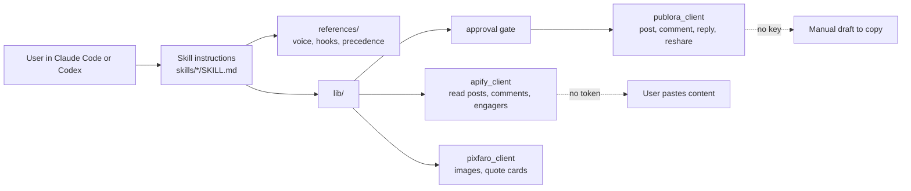
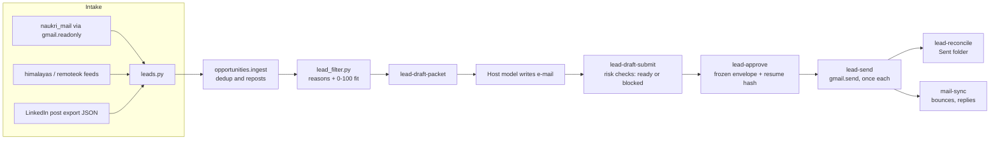
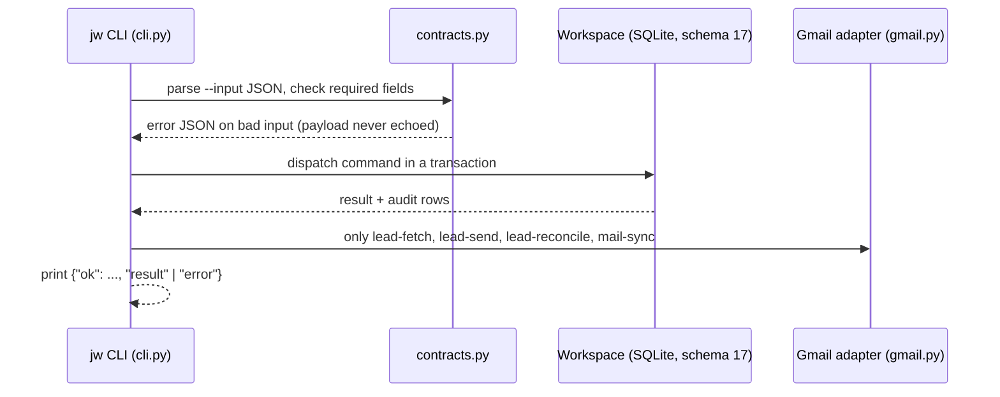

# groundwork-jobs

This repository holds two products that share one Git history:

| Product | What it is | Where | State |
| --- | --- | --- | --- |
| **linkedin-skills** | A plugin bundle of **12 LinkedIn skills** for Claude Code and Codex, with Python clients for reading (Apify), publishing (Publora) and images (Pixfaro) | `skills/`, `references/`, `lib/`, `.claude-plugin/`, `.codex-plugin/` | Shipped as a plugin (version in `.claude-plugin/plugin.json`) |
| **jw** (groundwork-jobs) | A local, evidence-first job-application workspace: a JSON command-line tool over a private SQLite workspace | `src/jw/`, `docs/`, `tools/` | Development checkpoint, **not an R1 release** (see `docs/implementation/IMPLEMENTATION_STATUS.md`) |

Maintained by [mdshahansha](https://github.com/mdshahansha). Licence: [MIT](LICENSE).

[Product analysis](#1-product-analysis) · [Features](#2-feature-analysis) ·
[Benefits](#3-benefits) · [User guide](#4-user-guide-beginners) ·
[Developer setup](#5-developer-setup) · [Architecture](#6-architecture) ·
[Opportunities](#7-opportunities) · [Troubleshooting](#8-troubleshooting)

The same analysis as separate documents, plus market positioning: [docs/product/](docs/product/README.md)
([summary](docs/product/EXECUTIVE_SUMMARY.md), [features](docs/product/FEATURES.md),
[user guide](docs/product/USER_GUIDE.md), [architecture](docs/product/ARCHITECTURE.md),
[market](docs/product/MARKET_POSITIONING.md), [opportunities](docs/product/OPPORTUNITIES.md)).

> Status labels used below. **Implemented**: code and tests exist in this repository.
> **Planned**: documented, no code. **Unsupported**: the code refuses it on purpose.
> **Needs Verification**: stated in docs or plausible, but not proven by a local check
> while this README was written.

---

## 1. Product analysis

### Problem

- **LinkedIn writing.** People who post and comment on LinkedIn want drafts in their own
  voice, without the phrasing that reads as machine-written, and with a safe path from
  draft to published post. The bundle drafts locally and publishes only after an explicit
  approval.
- **Job applications.** A job seeker who applies by e-mail to hiring posts repeats the
  same work every day: find fresh posts, drop the ones that do not fit, write a tailored
  e-mail that makes no false claims, send it once, and keep track. `jw` automates the
  mechanical parts and keeps the candidate in charge of every claim and every send.

### Target users

| User | Product | Need |
| --- | --- | --- |
| Founders, creators, marketers on LinkedIn | linkedin-skills | Posts, comments, replies, profile rewrite, content plans |
| Marketing or sales teams | linkedin-skills (`linkedin-employee-advocacy`) | Team posting programme and its measurement |
| Individual job seeker (the maintainer's own use case) | jw | Lead intake, filtering, honest per-post e-mails, approved sending |
| Developers who extend agent skills | both | A tested reference for read/write/image layers and evidence gates |

### Positioning

- **Draft first, act on approval.** Nothing in either product publishes or sends without
  a concrete approval by the user. In the bundle this is a skill convention (`lib/approval.py` says it is not runtime enforcement); in jw, `lead-send` only spends authorisations created by `lead-approve`.
- **Evidence over generation.** jw drafts may only state facts the candidate supplied;
  the checker blocks unsupported figures and technologies (`src/jw/lead_drafts.py`).
- **Local and private.** jw keeps candidate data in a workspace outside the repository.
  The SQLite database is not encrypted by this application.
- **Works without accounts.** The writing skills need no API key. Integrations only add
  capabilities.

### Market

No market sizing, user counts or competitor feature claims are made here: none were
measured for this repository. **Needs Verification** before any such claim is published.

---

## 2. Feature analysis

### 2.1 linkedin-skills: the 12 skills

| Skill | Purpose | Status |
| --- | --- | --- |
| [Post Writer](skills/linkedin-post-writer/SKILL.md) | Draft posts with the 20 hook formulas, your notes and requested Gmail context | Implemented |
| [Comment Drafter](skills/linkedin-comment-drafter/SKILL.md) | Comment on, or reshare, someone else's post | Implemented |
| [Reply Handler](skills/linkedin-reply-handler/SKILL.md) | Reply to one existing comment with the right parent target | Implemented |
| [Hook Extractor](skills/linkedin-hook-extractor/SKILL.md) | Identify the hook formula of an existing post and return a template | Implemented |
| [Humanizer](skills/linkedin-humanizer/SKILL.md) | Rewrite, audit (`--mode audit`) and profile (`--mode profile`) a draft's style | Implemented |
| [Profile Optimizer](skills/linkedin-profile-optimizer/SKILL.md) | Headline, About, Featured, Experience and other profile sections | Implemented |
| [Content Planner](skills/linkedin-content-planner/SKILL.md) | Seven-day plan with pillars, formats, hooks and engagement tasks | Implemented |
| [Repurposer](skills/linkedin-repurposer/SKILL.md) | Turn a blog, video, newsletter or e-mail into a native post | Implemented |
| [Employee Advocacy](skills/linkedin-employee-advocacy/SKILL.md) | Team publishing programme, guidelines and measurement | Implemented |
| [Thread Monitor](skills/linkedin-thread-monitor/SKILL.md) | Find your comments that earned author replies | Implemented |
| [Engager Analytics](skills/linkedin-engager-analytics/SKILL.md) | Segment the people who liked or commented on a post | Implemented |
| [Interviewer](skills/linkedin-interviewer/SKILL.md) | Collect experiences and figures into a Story Bank | Implemented |

"Implemented" here means the skill instructions exist and pass
`scripts/check_frontmatter.py` and the contract tests. Output quality of a skill is
graded only by `evals/run_evals.py`, which needs a model call per case: **Needs
Verification** per release.

Shared layers in `lib/`:

| Layer | Module | Calls | Without credentials |
| --- | --- | --- | --- |
| Read | `lib/apify_client.py` | `fetch_post`, `fetch_post_comments`, `fetch_user_recent_comments`, `fetch_post_engagers` (6 h LRU cache) | Paste the content |
| Write | `lib/publora_client.py` | `lib.publish(kind, ...)` for comment, reply, post, reshare; `lib.repost(...)` | Manual draft to copy |
| Image | `lib/pixfaro_client.py` | `lib.illustrate`, `lib.refine`, `lib.quote_card`, `lib.card`, `lib.brand_logo` | Image prompt only |
| Approval | `lib/approval.py` | Approval-card helpers skills call before a write (convention, not runtime enforcement) | n/a |

Apify actors called by the read client:

| Use case | Actor |
| --- | --- |
| Post body | `apimaestro/linkedin-post-detail` |
| Post comments and replies | `apimaestro/linkedin-post-comments-replies-engagements-scraper-no-cookies` |
| A user's recent comments | `apimaestro/linkedin-profile-comments` |
| Post likers and commenters | `scraping_solutions/linkedin-posts-engagers-likers-and-commenters-no-cookies` |

Provider usage may be billed; check current pricing before large fetches. For an Apify
MCP connection see [references/mcp-read-layer.md](references/mcp-read-layer.md).

Other parts:

- `automation/`: a Node 20 daily comment-candidate workflow. Its own header says it is
  draft-only and never publishes; publishing goes through an explicit approve queue
  (`npm run queue:build`, `queue:show`). Run from `automation/`; tests: `npm test`.
- `evals/run_evals.py`: behaviour evals against fixtures (`--list`, `--record`).
- `.claude/skills/`: relative symlinks to `skills/` so a plain clone activates the skills
  in Claude Code.

### 2.2 jw: job workspace

The CLI is `python -m jw` (installed script: `jw`). Every command takes
`--workspace <dir>` and, where needed, `--input <request.json>`, and prints one JSON object
(`{"ok": true, "result": ...}` or `{"ok": false, "error": {...}}`). `--dry-run` runs on a
throwaway copy. The workspace schema is version 17.

Tickets JW-01..25 are tracked in
[IMPLEMENTATION_STATUS.md](docs/implementation/IMPLEMENTATION_STATUS.md). That file
marks every ticket "Implemented and verified for supported runtime paths" (JW-01:
planning only) and also states the checkpoint is **partial, not M1 or R1 completion**.

| Area | Commands (from `COMMANDS` in `src/jw/cli.py`) | Module | Status |
| --- | --- | --- | --- |
| Workspace | `init`, `status`, `schema`, `backup`, `checkpoint`, `pause`, `resume` | `workspace.py`, `backup.py` | Implemented |
| Evidence and profile | `source-import`, `claim-add`, `claim-correct`, `profile-set`, `profile-publish`, `profile-map` | `workspace.py` | Implemented |
| Paraphrase checks (JW-05) | `paraphrase-check`, `-approve`, `-review-packet`, `-review-submit`, `-revoke` | `semantics.py` | Implemented |
| Privacy (JW-03) | `disclosure-rule`, `-grant`, `-revoke`, `-preview`, `delete-preview`, `source-delete` | `privacy.py` | Implemented |
| Jobs and ranking (JW-07) | `job-add`, `post-ingest`, `policy-set`, `policy-show`, `mapping-*`, `rank`, `rankings`, `rankings-refresh` | `policy.py`, `ranking.py`, `opportunities.py` | Implemented |
| Host-model tasks (JW-08, JW-10) | `task-create`, `task-packet`, `task-submit`, `task-failure`, `task-resume`, `extraction-*`, `usage-report`, `model-pin` | `tasks.py`, `contracts.py` | Implemented (model runs manually in the host) |
| Private drafts and PDF (JW-09) | `draft-export`, `draft-render`, `draft-verify`, `draft-readiness`, `render-font`, `handoff-preview` | `rendering.py`, `verification.py`, `visual.py` | Implemented; PDFs stay **PRIVATE DRAFT - NOT READY** |
| Mail and outcomes (JW-14, JW-15) | `mail-sync`, `mail-review`, `outcome-record`, `application-state`, `activity-record`, `activity-time` | `mailsync.py`, `followups.py` | Implemented |
| History and suppression (JW-13, JW-22) | `history-import`, `-show`, `-export`, `archive-import`, `suppress`, `merge-decide`, `merge-undo` | `history.py`, `csv_archive.py`, `suppression.py` | Implemented |
| Scheduling and metrics (JW-19, JW-23) | `schedule-set`, `schedule-next`, `metrics`, `opportunities` | `schedule.py`, `metrics.py` | Implemented |
| Local API (JW-17) | WSGI app bound to 127.0.0.1 | `api.py` | Implemented, no CLI command |
| Refused on purpose | `ready-export`, `send`, `ats-submit`, `capture`, `schedule` | `UNSUPPORTED` in `cli.py` | Unsupported: returns `unsupported_capability` |
| Restore | `restore` | `backup.py` | Listed, but `status` reports `restore: unsupported`; the old README warns restore safety is unfinished |

**Lead pipeline** ([LEAD_PIPELINE.md](docs/implementation/LEAD_PIPELINE.md)):

| Phase | Commands | Module | Status |
| --- | --- | --- | --- |
| 1. Intake | `lead-import` (LinkedIn post export), `lead-fetch` (`naukri_mail`, `himalayas`, `remoteok`) | `leads.py` | Implemented |
| 2. Filters and fit | `lead-filter` (age, years, location, stack, role, already-applied, poster volume; 0-100 fit) | `lead_filter.py` | Implemented |
| 3. Drafting | `lead-draft-packet`, `lead-draft-submit`, `lead-drafts` | `lead_drafts.py` | Implemented |
| 4. Send queue | `lead-approve`, `lead-send`, `lead-reconcile` | `lead_queue.py`, `gmail.py` | Implemented |
| 5. Dashboard | pipeline counts, daily runs, errors | none | Planned |
| 6. Daily run | scheduled intake, filter, drafting; waits for batch approval | none | Planned |

Note: the generic `send` command is unsupported, and `status` reports
`send: unsupported`. Approved lead e-mails go only through `lead-send`, which needs a
`gmail.send` token. The CLI's `--help` text still says "no external actions"; that
predates `lead-send`.

---

## 3. Benefits

| Benefit | How the code delivers it | Where |
| --- | --- | --- |
| No false claims in applications | Draft checker blocks figures and technologies absent from the facts file | `src/jw/lead_drafts.py` |
| Each e-mail sent at most once | Attempt reserved before the provider call; a lost response is `unknown`, never resent; `lead-reconcile` settles it from Sent | `src/jw/lead_queue.py` |
| Wrong attachment stopped | Send refused when the resume hash differs from the approved one | `src/jw/lead_queue.py` |
| Less time on dead leads | Filters with reason codes and a ranked CSV export | `src/jw/lead_filter.py` |
| No duplicate applications | Layered dedup plus applied-tracker and suppression checks | `opportunities.py`, `suppression.py` |
| Private by default | Workspace outside the repo, restricted fields kept out of CVs and model packets | `privacy.py`, `docs/architecture/DISCLOSURE_POLICY.md` |
| Drafts in your own voice | Voice rules, humanizer audit, Story Bank | `references/voice-rules.md`, `skills/linkedin-humanizer/` |
| Safe publishing | Skills show an approval card before any Publora write; manual fallback without a key | `lib/approval.py`, `lib/publora_client.py` |
| Works offline | Writing skills and local jw commands need no account | `.env.example` (all optional) |

---

## 4. User guide (beginners)

### 4.1 Use the LinkedIn skills

**Claude Code:**

```text
/plugin marketplace add mdshahansha/linkedin-skills
/plugin install linkedin-skills@linkedin-skills
```

To use a local checkout, run `/plugin marketplace add .` from its root instead.

**Codex**, from this checkout:

```bash
python3 scripts/sync_codex_marketplace.py
codex plugin marketplace add .
codex plugin add linkedin-skills@linkedin-skills
```

Then ask in plain words, for example:

- "Draft a LinkedIn post from these notes. Keep the figures exactly as supplied."
- "Write three comment options for this LinkedIn post: <url>."
- "Audit this draft with the humanizer before I publish."
- "Plan seven days of content for a founder selling to engineering teams."

You always see the draft first. Publishing happens only after you approve, and only if
Publora is connected. Without it you get text to copy.

For a consistent voice, fill in [references/voice-profile.md](references/voice-profile.md)
and [references/story-bank.md](references/story-bank.md).

**Gmail as source material.** The Codex manifest declares the Gmail app in
[.app.json](.app.json); the host asks you to connect it. In Claude Code, connect Gmail
through the host's own connector. The bundle reads requested messages; sending,
deleting or relabelling needs explicit approval. See
[references/gmail-workflow.md](references/gmail-workflow.md).

### 4.2 Use jw for job applications

Keep the workspace **outside** this repository and outside synced folders.

1. Install (Python 3.11+):

   ```bash
   python3 -m venv .venv
   .venv/bin/python -m pip install .
   ```

2. Create a workspace and check it:

   ```bash
   .venv/bin/jw --workspace ~/.local/share/jw/main init
   .venv/bin/jw --workspace ~/.local/share/jw/main status
   ```

3. Bring in leads. Each `--input` is a JSON file, for example `{"source": "remoteok"}`:

   ```bash
   .venv/bin/jw --workspace ~/.local/share/jw/main lead-fetch --input fetch.json
   ```

4. Filter, then read the reasons and the ranked list:

   ```bash
   .venv/bin/jw --workspace ~/.local/share/jw/main lead-filter --input filter.json
   ```

5. Draft each e-mail with your host model from `lead-draft-packet`, store it with
   `lead-draft-submit`, and list results with `lead-drafts`. A `blocked` draft shows why.
6. Approve the batch with `lead-approve`, then send with `lead-send`. Settle any
   `unknown` sends with `lead-reconcile`.

Sending needs Gmail access. Run this once with a Google "Desktop app" OAuth client:

```bash
python3 tools/gmail_oauth_setup.py --env /path/to/.env --client-json /path/to/client_secret.json
```

It writes `JW_GMAIL_CLIENT_ID`, `JW_GMAIL_CLIENT_SECRET` and `JW_GMAIL_REFRESH_TOKEN` to
that env file with mode 600. Publish the consent screen "In production"; in "Testing"
Google expires refresh tokens after 7 days. Input field names for every command are in
`COMMANDS` in `src/jw/cli.py` and in `docs/architecture/API_CONTRACTS.md`.

Error codes worth knowing: `unsupported_capability` means the feature is disabled, not
that it succeeded. `profile_unpublished` means correct and publish the profile first.
`stale_input` means create a new task. Do not edit the database to clear a gate.

---

## 5. Developer setup

```bash
git clone https://github.com/mdshahansha/groundwork-jobs.git
cd groundwork-jobs
python3 -m venv .venv && . .venv/bin/activate
python3 -m pip install -r requirements.txt -r requirements-dev.txt
python3 -m pip install -e '.[render-test]'
```

The plugin install commands above use the published `mdshahansha/linkedin-skills` repository.

Optional integrations, set only what you use (names from [.env.example](.env.example);
values below are placeholders):

```bash
APIFY_TOKEN=<your-apify-token>
PUBLORA_API_KEY=<your-publora-key>
LINKEDIN_PLATFORM_ID=<linkedin-xxxx>
PIXFARO_TOKEN=<your-pixfaro-token>
```

Keep real credentials out of tracked files. `testing/` is gitignored scratch for local
keys and samples.

### Validation before push

From the repository root (the list in [CLAUDE.md](CLAUDE.md)):

```bash
python3 -c "from lib import publish, fetch_post, illustrate, refine, ApifyClient, PubloraClient, PixfaroClient; print('OK')"
python3 scripts/sync_codex_marketplace.py
ls skills/ | wc -l
python3 scripts/check_frontmatter.py
python3 scripts/check_no_secrets.py
python3 scripts/check_config.py --offline
python3 scripts/check_actor_inputs.py
python3 scripts/check_traceability.py
python3 -m unittest discover -s tests
python3 scripts/selftest.py
```

`ls skills/ | wc -l` must print 12. Also useful: `python3 scripts/check_markdown_references.py`,
`python3 tools/check_release_plan.py`, and `npm test` inside `automation/`.

### Conventions

- Version lives in four manifests: `.claude-plugin/plugin.json`,
  `.claude-plugin/marketplace.json`, `.codex-plugin/plugin.json`,
  `.agents/plugins/marketplace.json`. Bump the patch number by default.
- Never edit `.codex-marketplace/linkedin-skills/` by hand; run the sync script.
- Exactly 12 skills; no em dashes in skill `description:` fields.
- Read [CLAUDE.md](CLAUDE.md) or [AGENTS.md](AGENTS.md) before contributing.

### Layout

```text
.claude-plugin/ .codex-plugin/ .agents/   plugin manifests and marketplace entries
.codex-marketplace/                        generated Codex package (sync script output)
skills/                                    the 12 skill sources
references/                                shared voice, hook, Gmail and safety rules
lib/                                       Apify, Publora, Pixfaro clients and approval gate
scripts/                                   sync and validation tools
automation/                                Node daily comment-candidate workflow
evals/                                     behaviour evals
src/jw/                                    job workspace runtime
tools/                                     jw probes, OAuth setup, release-plan check
docs/                                      PRD, HLD, architecture, implementation status
tests/                                     unit, contract and end-to-end tests
```

---

## 6. Architecture

### 6.1 linkedin-skills



### 6.2 jw lead pipeline



### 6.3 jw command path



Deeper design: [HLD](docs/architecture/HLD.md), [LLD](docs/architecture/LLD.md),
[database](docs/architecture/DATABASE_DESIGN.md), [data flow](docs/architecture/DATA_FLOW.md),
[security and privacy](docs/architecture/SECURITY_AND_PRIVACY.md).

---

## 7. Opportunities

Ordered by value to the current user and by how much code already exists.

| # | Opportunity | Why | Effort |
| --- | --- | --- | --- |
| 1 | Lead pipeline phase 6: daily run | Intake, filter and drafting already exist as commands; a scheduled run that stops at batch approval removes the daily manual chain | Medium |
| 2 | Lead pipeline phase 5: dashboard | Counts per stage, sends, unknowns and errors; data is already in the workspace | Medium |
| 3 | Poster-volume check for LinkedIn leads | Leads keep `checks_pending: poster_unverified` until a profile check | Small |
| 4 | Live `naukri_mail` run | Parser is tested only on a synthetic invite (per LEAD_PIPELINE.md) | Small |
| 5 | Fix CLI help text | `--help` says "no external actions" while `lead-send` sends | Trivial |
| 6 | Safe restore | `restore` is listed but reported unsupported | Medium |
| 7 | Workspace encryption | SQLite holds personal data unencrypted | Medium |
| 8 | Recorded eval runs per release | Skill quality is only graded by `evals/run_evals.py` on demand | Small |

---

## 8. Troubleshooting

| Symptom | What to check |
| --- | --- |
| Gmail tools missing in a skill | Reload the plugin, check the host's Gmail connection, start a new conversation |
| Skill reports manual mode with a working connector | Shell checks read env variables, not host-managed connectors |
| LinkedIn content cannot be fetched | Set `APIFY_TOKEN` or paste the text |
| Publishing unavailable | Check `PUBLORA_API_KEY` and `LINKEDIN_PLATFORM_ID`; manual drafts still work |
| Plugin shows old behaviour | Reinstall or refresh the cached package; local edits do not refresh it |
| Symlinks in `.claude/skills/` are text files on Windows | Use plugin installation or a checkout with working symlinks |
| `jw` returns `unsupported_capability` | The feature is disabled on purpose; nothing happened |
| Gmail refresh token stops after 7 days | Consent screen is in "Testing"; publish it "In production" and rerun `tools/gmail_oauth_setup.py` |
| Frontmatter check needs PyYAML | Install `requirements-dev.txt` |

Security policy: [SECURITY.md](SECURITY.md). Untrusted-content rule:
[references/untrusted-content.md](references/untrusted-content.md).
