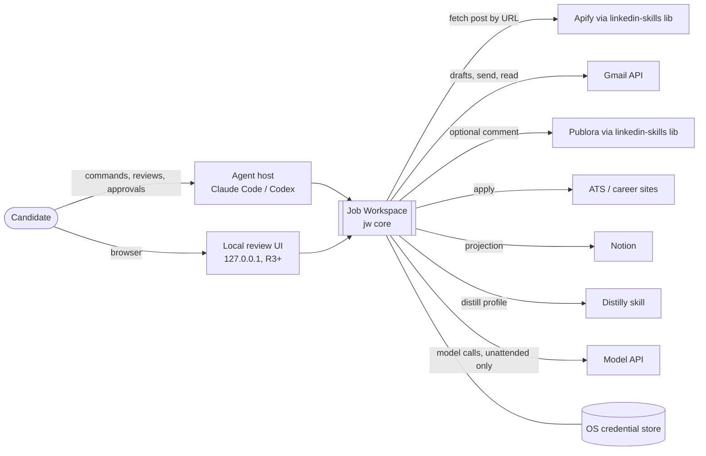
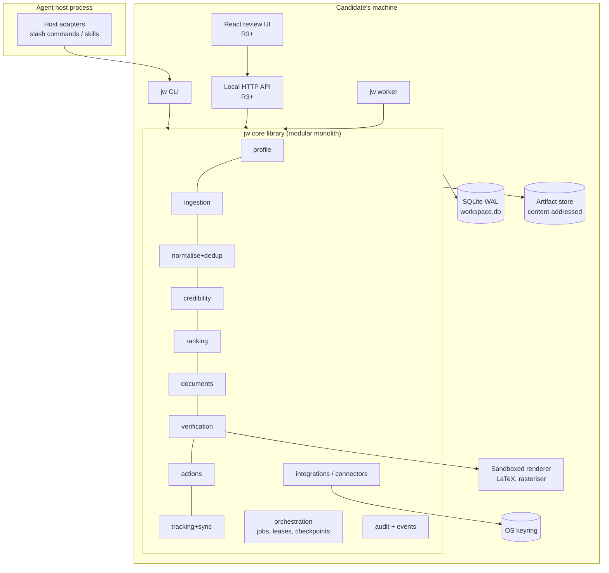
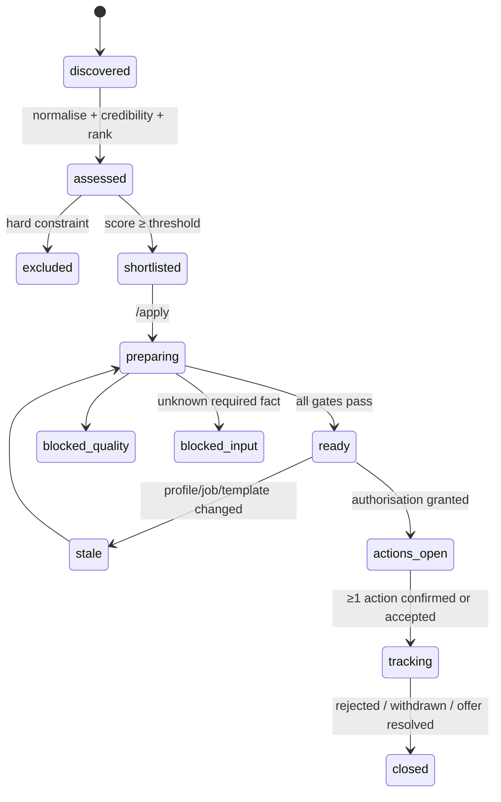
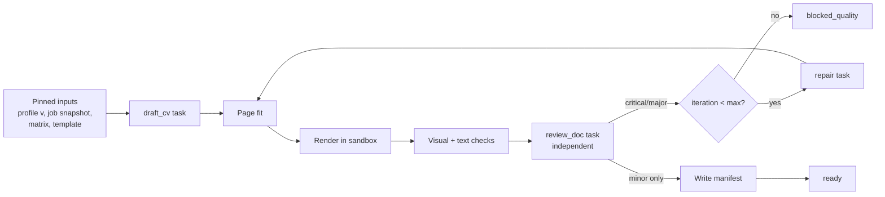
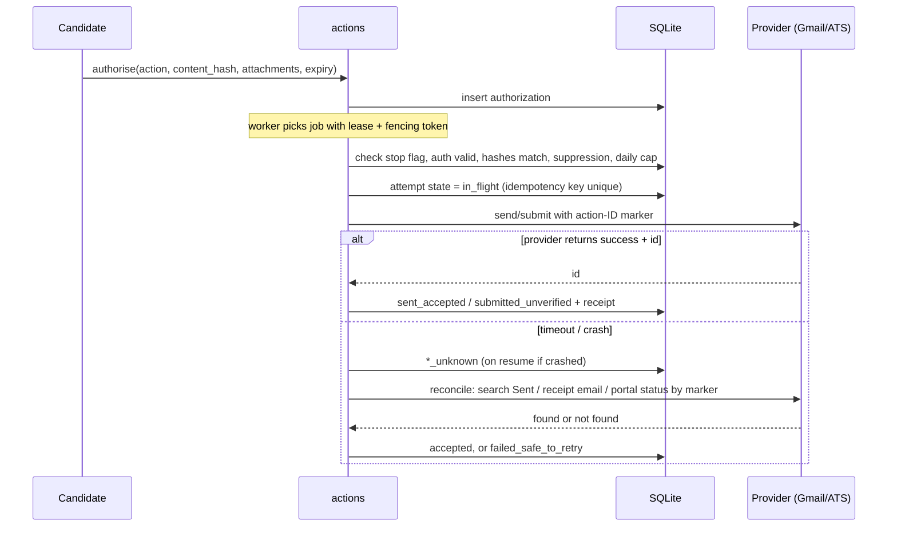
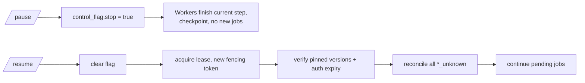
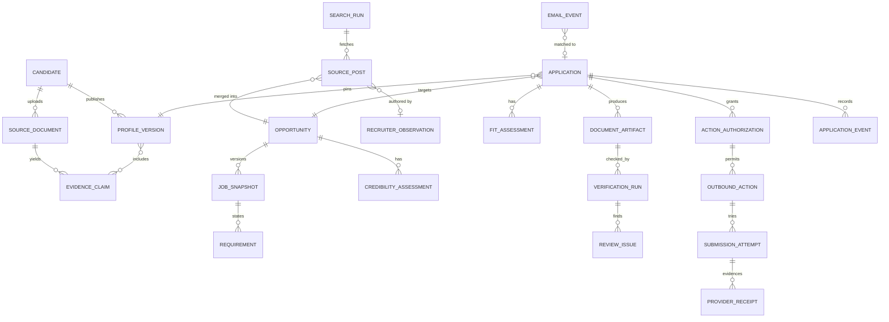
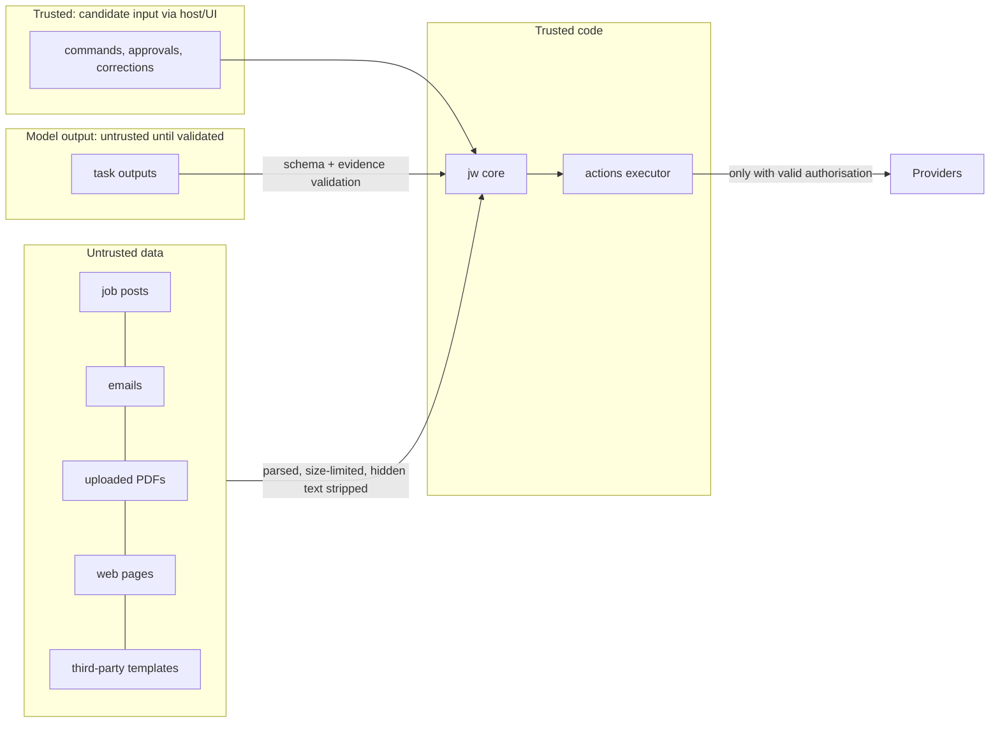

# AI Job Application Workspace — High-Level Design

Version 0.2 | 28 October 2026 | Status: Proposed (not implemented)
Implements: `02-prd.md` v1.1. Next: `04-lld.md`.

Delivery planning amendment: [JW-01 release dependency plan](05-release-plan.md) defines the R1 prerequisite contracts and internal M1 milestone. The local API and browser capture both start in R3. ModelRunner, ingestion normalization, policy pinning, and minimum telemetry are R1 foundations; no later-release adapter is required to complete M1.

## 0. Hinglish summary

Pehli release ke liye ek **local-first modular monolith** recommend kiya gaya hai: ek Python core (`jw` CLI + library), ek background worker process, SQLite database, aur content-addressed artifact folder. Claude Code / Codex ke slash commands sirf patle adapters hain jo `jw` ko call karte hain; saari deterministic logic (validation, dedup, state machines, hashes, authorisation checks) code mein hai, prompts mein nahi. Model ka kaam (extraction, drafting, review) ek `ModelRunner` port ke peeche hai, jo host agent ya API dono se chal sakta hai. Microservices nahi chahiye: ek user, kuch sau jobs per week, aur sabse bada risk duplicate email/submission hai, jise database ke unique constraints aur leases solve karte hain, network hops nahi.

## 1. Evidence status

| Label | Meaning |
| --- | --- |
| **Observed** | Inspected on 27 Oct 2026 (paths and commits below). |
| **Prior knowledge** | From the author's training knowledge of provider docs; **not re-fetched this session**. Must be verified against official docs in Phase 0 before implementation. |
| **Proposed** | Design in this document. |

## 2. Repository inputs

| Repository | URL / path | Branch | Commit | Licence | What it is | Inspection depth |
| --- | --- | --- | --- | --- | --- | --- |
| `j-a` | `github.com/mdshahansha/j-a`, local `Desktop/ja` | `master` | `72252c9` | None found | One instruction skill `job-skill` (`SKILL.MD`, `readme.md`). No code, no tests. | Full read of both tracked files |
| `linkedin-skills` | local `Desktop/ja/linkedin-skills` (nested, untracked in `j-a`) | `main` | `f538518` | See its `LICENSE` | LinkedIn content skills + `lib/` Apify read, Publora write, Pixfaro image layers | `lib/` API surface via its CLAUDE.md; not a code audit |
| Distilly | `github.com/titanwings/distilly` | — | **not inspected** | **unknown** | Source-grounded person profiles as agent skills (per brief) | None this session |

Observed facts about `j-a` that affect design:

- `SKILL.MD` links `references/platform-flows.md`, `references/email-and-automation.md`, `references/state-and-tracking.md`. **None are committed.** The links are broken.
- `readme.md` lists the file as `README.md` and the tree as `job-skill/...`; actual tracked names are `SKILL.MD` (uppercase extension) and `readme.md`. Case-sensitive hosts may not discover `SKILL.MD`.
- The multi-command tree in the brief (`.claude/commands/*.md`, `cv/`, `tools/verify_pdf.py`, `job_search_tracker.csv`, ...) **does not exist** in `j-a`. It is treated as a proposed layout (§13).
- `job-skill` already encodes rules this design keeps: stop at CAPTCHA/OTP/MFA; a button click is not proof of submission; `submission_unverified`; never blind-retry; unknown eligibility is a question; fit score is not a hiring probability.
- Conflicts with the PRD, resolved here:

| Topic | `job-skill` today | PRD / HLD decision |
| --- | --- | --- |
| Easy Apply | Lists "fill applications through LinkedIn Easy Apply" | Only as **user-present browser assistance** in the user's own browser session, never headless automation; else manual handoff (FR-APP-01). |
| Ranking weights | skills 30, experience 20, seniority 20, domain 20, education 10; shortlist ≥ 60 | PRD v1 weights (FR-RNK-02). `job-skill` weights kept as a selectable **v0 weight set** for continuity. |
| Repair loop | ≤ 2 revision passes | Default 3, configurable (FR-DOC-07). Set 2 to match old behaviour. |
| Approval | "Do not invent a generic approval gate before every click" | Agrees: authorisation is per external action or campaign, not per click (FR-AUT-01/02). |
| State storage | Host session or ad-hoc local files | SQLite + artifact store (§6). |

## 3. Architecture drivers

From PRD NFRs, ranked:

1. **No duplicate or unauthorised external actions** (NFR-REL-01, FR-AUT-03). Drives: transactional state, unique idempotency keys, leases with fencing, reconcile-before-retry.
2. **Truthfulness and traceability** (NFR-TRU-01). Drives: claim/evidence store, immutable manifests, deterministic gates outside the model.
3. **Privacy, local by default** (NFR-PRV-01/02). Drives: single-machine deployment, OS credential store, context packets.
4. **Survive host stops and quota exhaustion** (FR-RES). Drives: durable checkpoints independent of the agent session.
5. **Run inside agent hosts** (Claude Code, Codex) **and** headless for scheduled runs. Drives: thin host adapters over a CLI; pluggable model runner.
6. Low operating cost and simple install for one person.

Scale assumptions (single user): ≤ 2,000 discovered items/week, ≤ 300 normalised jobs/week, ≤ 50 prepared applications/week, ≤ 20 emails/day, ≤ 5 GB artifacts/year. Ten times these numbers still fits the chosen design.

## 4. Architecture options

| Criterion | A. Local file-first tool (Markdown + JSON files, no DB) | **B. Modular monolith + local worker (SQLite)** | C. Distributed services (API, queue, workers, Postgres) |
| --- | --- | --- | --- |
| Duplicate-action safety | Weak: no atomic check-and-set across files | Strong: transactions + unique constraints | Strong, but needs distributed locks/outbox across services |
| Crash recovery | Manual | Durable job table + leases | Durable, more moving parts |
| Install | Trivial | `pipx install` + optional LaTeX | Docker compose, ports, DB server |
| Privacy | Local | Local | Usually hosted → new data-protection surface |
| Fits agent hosts | Yes | Yes (CLI) | Needs network API from the host |
| Multi-user | No | Path via Postgres + tenant column | Yes |
| Ops cost | None | Near none | High |

**Decision (ADR-001): Option B.** A cannot enforce idempotency; C buys multi-tenancy the product does not need yet and adds failure domains (network, queue, schema drift between services). B keeps module boundaries so modules can be extracted later if multi-user hosting is ever built.

### Technology selection (ADR-002)

| Component | Choice | Why it exists | Deferrable? |
| --- | --- | --- | --- |
| Core language | **Python** | PDF/LaTeX tooling, text extraction and rasterisation libraries are Python-first; `linkedin-skills/lib` is Python; one language for CLI, worker and gates. | No |
| Database | **SQLite (WAL mode)** behind a repository layer | Transactions, unique constraints, partial indexes; single file, easy backup. | No. Postgres is the multi-user upgrade path (§11.4). |
| Artifact store | Content-addressed folder `artifacts/<sha256[:2]>/<sha256>` | Immutable files, dedup, hash = identity for authorisation binding. | No |
| Worker | Same Python package, `jw worker` process | Runs queued jobs with leases; can be started by an OS scheduler. | Manual mode in R1 if no scheduler |
| Host adapters | `.claude/commands/*.md`, `.agents/skills/*`, `SKILL.md` | Thin; call `jw`. | No |
| Local web UI | **React + TypeScript** SPA served by a small Python HTTP API on `127.0.0.1` | Review screens (diffs, PDF preview, authorisation) are hard in a terminal. | **Yes → R3** (action review). R1–R2 use CLI + generated HTML views. |
| Node.js API | **Not used** | Would duplicate the Python domain layer. | — |
| Document build | LaTeX in sandbox (FR-SEC-05); Typst later through the template interface | Matches the brief's existing templates. | Typst deferred |
| Model access | `ModelRunner` port: `HostAgentRunner`, `ApiRunner` | §8 | `ApiRunner` needed only for unattended runs |

Exact library and runtime versions are selected from official sources during implementation; none are fixed here.

## 5. System context



*Caption:* The workspace is the only component that talks to providers. The agent host and local UI are clients. Recruiters and employers are reached only through Gmail, ATS or Publora, and only by the action executor (§7).

## 6. Containers



*Caption:* CLI, local API and worker are three entry points into one library. Only `integrations` reads credentials. Only `actions` calls side-effecting provider methods. `SBX` runs as a child process with no network and no shell-escape.

### 6.1 Sync vs async boundaries

| Operation | Mode | Reason |
| --- | --- | --- |
| Profile edit, policy edit, `/outcome`, `/status`, authorisation grant/revoke | Sync (CLI/API, single transaction) | Fast, user waiting |
| Import of one URL, `/rank` | Sync with checkpoint | Seconds to a minute |
| `/setup` distillation, `/apply` pipeline, `/search`, `/gmail-sync`, external actions | **Async job** in `jobs` table; CLI can run it inline (`--wait`) or hand it to the worker | Long, retryable, must survive host stop |
| Rendering | Child process, awaited by verification job | Isolation |

## 7. Modules

| Module | Responsibility | Owns (tables/artifacts) | Calls | PRD |
| --- | --- | --- | --- | --- |
| `profile` | Claims, evidence, profile versions, projections, conflicts, Distilly adapter | `candidate`, `source_document`, `evidence_claim`, `profile_version`, `preference_set` | `integrations.distilly`, `orchestration` | PRF, DST, ONB |
| `ingestion` | Source adapters, capability registry, cursors, snapshots | `search_run`, `source_post`, `job_snapshot`, `ingest_cursor` | `integrations.*` read methods | IMP, DIS |
| `normalise` | Field extraction, canonical URL, fingerprints, dedup, merge/unmerge | `opportunity`, `merge_decision`, `recruiter_observation` | model runner (extraction) | DIS-02, DED, FRQ |
| `credibility` | Indicators, states, overrides, expiry | `credibility_assessment` | — | CRD |
| `ranking` | Hard constraints, requirement matrix, weighted score | `requirement`, `fit_assessment`, `weight_set` | model runner (requirement mapping) | RNK |
| `documents` | Templates, drafting, page fitting, repair loop driver | `application`, `document_artifact`, `template_version` | model runner, `verification` | DOC-01/02/05/07 |
| `verification` | Render, visual, text extraction, review, manifest | `verification_run`, `review_issue`, manifests (artifact) | sandbox, model runner (review) | DOC-03/04/06/08 |
| `actions` | Authorisation checks, outbound actions, attempts, receipts, reconciliation, suppression | `action_authorization`, `outbound_action`, `submission_attempt`, `provider_receipt`, `suppression` | `integrations.*` write methods | AUT, EML, CMT, APP |
| `tracking` | Outcomes, Gmail sync, matching, projections (Notion, HTML) | `application_event`, `email_event`, `sync_cursor` | `integrations.gmail` read | TRK, SYN, RPT |
| `orchestration` | Job queue, leases, fencing, stop flag, checkpoints, retries | `job`, `run_checkpoint`, `control_flag`, `skill_version` | all modules via commands | RES |
| `audit` | Append-only events, outbox, redacted logs | `event`, `outbox` | — | NFR-OBS-01 |
| `integrations` | Connector clients, credentials, rate limits, capability declarations | `connector`, `rate_window` | keyring, network | DIS-01, APP-01 |

Rules:
- Modules talk through their public Python interface, never another module's tables.
- Only `actions` may invoke a connector method marked `side_effect=True`. Enforced by an import-linter rule and a runtime guard that checks a capability token passed only by `actions`.
- `linkedin-skills/lib` is consumed as a pinned external package by `integrations.apify` and `integrations.publora`; nothing is copied.

## 8. Model work vs deterministic work

| Deterministic (code) | Model (structured output, validated by code) |
| --- | --- |
| Schema validation, URL/email/date checks | Claim extraction from CVs and posts |
| Hashing, canonical URLs, fingerprints, exact dedup | Requirement extraction from job text |
| Frequency counting and coverage logic | Requirement-to-evidence mapping rationale |
| Hard constraints, weighted score arithmetic | Drafting CV bullets, letters, emails |
| Rendering, bbox overlap, font, Unicode, link checks | Independent review findings |
| Authorisation binding, idempotency, state transitions | Email reply classification (labelled `inferred`) |
| Page-fit trimming order once items are scored | Relevance/impact scoring of candidate items |

**ModelRunner port.** Each model task is a named, versioned task (`extract_claims@1`, `draft_cv@1`, `review_doc@1`, ...) with a JSON input schema (the *context packet*) and a JSON output schema.

- `HostAgentRunner` (default in R1): `jw` writes the packet to `runs/<run>/packets/<task>.json` and returns `NEEDS_MODEL`. The host adapter (the slash command) has the agent produce the output file; `jw task submit` validates it against the schema and evidence rules. No API key needed.
- `ApiRunner`: same packets, sent to a model API by the worker for unattended runs (scheduled `/search`, `/gmail-sync`). Requires an API key in the keyring.
- Reviewer tasks never receive the drafter's packet or reasoning, only the draft, evidence and policy (FR-DOC-06).
- Packets are bounded: pinned profile version, only relevant claims, job snapshot, requirements, draft hashes, current findings, next task. Restricted claims are excluded unless the task is an approved ATS field mapping (NFR-PRV-01).
- Packets and validated outputs are cached by `(task@version, input hash)`; a changed input hash is a miss.

**R1 dependency closure.** `ingestion` exposes the import capability contract and normalized snapshot records before `ranking` consumes them. `ranking` and `verification` pin immutable policy versions from R1. `credibility` exposes an `unassessed` status without pretending the R2 indicator engine exists; local preparation requires candidate review. `orchestration` records per-step time and available model usage from R1; aggregate reporting remains R5. The minimum usable path uses HostAgentRunner or a verified API runner, built-in Distilly fallback, pasted job text, and the pinned renderer. Gmail and ATS connectors are not prerequisites.

**Optional capability boundaries.** Empty research/style inputs and a versioned default claim-selection policy must not bypass any quality gate. Salary values with incompatible or unknown bases remain uncomparable. R1 export separates employer-ready documents from private evidence/manifest material and does not invoke the R4 application workflow. The local API and quick capture activate together in R3; R2 digest delivery stays local. R2 alert ingestion verifies read consent independently of R3 sending.

## 9. Key flows

### 9.1 Application lifecycle (per opportunity)



*Caption:* Preparation and actions are separate. `actions_open` holds independent per-channel action machines (§9.3), so "email sent, ATS not submitted" is representable. Employment outcomes (interview, rejected, ...) live in `application_event`, not in this machine.

### 9.2 Draft → review → repair → verify



*Caption:* Every repair goes back through fit, render and checks, so a layout change can never skip re-verification. The manifest is written only on the success path; `blocked_quality` stores remaining findings.

### 9.3 External action and reconciliation



*Caption:* The idempotency key is unique per `(authorization_id, action_id)`; the `in_flight` row is committed before the provider call. A worker that finds `in_flight` with an expired lease never re-sends: it reconciles first. ATS `submitted_unverified` becomes `confirmed` only with a receipt (FR-APP-04).

### 9.4 Pause / resume



*Caption:* A host session ending is treated like a crash: the lease expires and the next `jw` invocation or worker resumes from `run_checkpoint`. Nothing assumes a fixed quota reset time.

### 9.5 Discovery

`/search` → for each permitted adapter with `search` capability: fetch pages from cursor → store `source_post` (raw hash) → normalise → dedup → recruiter observation → frequency assessment → credibility → rank → shortlist. Adapters without `search` contribute only user-supplied URLs. Each stage records counts on `search_run` for the funnel report.

## 10. Core data model (overview)



*Caption:* Manifests, PDFs, source files and context packets are immutable artifacts referenced by hash; everything above is a table. `SkillVersion` and `RunCheckpoint` are tables owned by `orchestration`. Field-level schemas, constraints and indexes are in `04-lld.md`.

## 11. Deployment

### 11.1 Workspace layout on disk

```text
<workspace>/                 # user data, NOT the code repo; default ~/JobWorkspace
  workspace.db               # SQLite, WAL
  artifacts/                 # content-addressed, immutable
  profile/projections/       # generated Markdown for host skills (read-only)
  config/search-policy.yaml
  runs/<run-id>/progress.json, decisions.md, open_questions.md, packets/
  backups/
```

Code and user data are separate, so `git pull` of the repository never touches candidate data and the repository can stay public.

### 11.2 Local development

Synthetic fixture workspace under `tests/fixtures/workspace/`; every connector has a mock selected by `JW_CONNECTORS=mock`; CI never holds real credentials and never sends.

### 11.3 Single-user install and upgrade

- Install: `pipx install` of the package; optional LaTeX toolchain detected by `jw doctor` (reports `TOOLCHAIN_MISSING` early instead of failing later).
- Upgrade: schema migrations run forward only after an automatic backup; `jw migrate --dry-run` previews. Rollback = restore the pre-migration backup with the previous package version.
- Backup: `jw backup` = SQLite online backup + artifacts + config, never secrets. Restore validates schema version, then forces reconciliation of `*_unknown` actions before any execution (FR-ADM-03).
- Secrets: OS keyring (Windows Credential Manager, macOS Keychain, Secret Service). Fallback `.env` outside the workspace with a warning. Redaction filter on all log handlers.

### 11.4 Future multi-user (not in scope)

Postgres with `tenant_id` on every table and row-level security; per-tenant artifact encryption keys; OAuth tokens in a managed secret store; per-tenant worker queues. Module boundaries in §7 are the extraction seams. Not built until a hosted product is decided.

## 12. Integration feasibility

Confidence: **High** = observed in code; **Medium** = prior knowledge, widely documented; **Low** = uncertain or likely restricted. All Medium/Low rows are Phase 0 verification tasks.

| Capability | Access mechanism | Permission | Verified availability | Restrictions | Manual fallback | Effort | Confidence |
| --- | --- | --- | --- | --- | --- | --- | --- |
| Fetch LinkedIn post by URL | Apify actor via `linkedin-skills` `fetch_post` | Apify token | Observed (method exists) | Actor terms, cost per run, public posts only | Paste text | S | High |
| LinkedIn keyword search of hiring posts | No official public API (prior knowledge) | — | Not available | LinkedIn terms prohibit scraping | User pastes URLs; job-alert emails parsed via Gmail | — | Low |
| Recruiter posting history | Apify `fetch_user_recent_comments` covers comments, not posts | Apify token | Partial at best | Incomplete coverage → FRQ `unknown` | None | M | Low |
| Job-board listings (non-LinkedIn) | Per board: official feeds/APIs where offered, else user URLs | Per board | Unverified | Varies; robots + terms checked by `/add-portal` | Paste URL | M per board | Low |
| Employer career pages | HTTP fetch of public page | None | Generally possible | robots, SSRF rules (FR-SEC-04) | Paste | S | Medium |
| Gmail create draft | Gmail API `drafts.create` | OAuth `gmail.compose` | Prior knowledge | Scope verification for distributed apps; personal test-mode use possible | `.eml` file opened manually | M | Medium |
| Gmail send | Gmail API `messages.send` / `drafts.send` | `gmail.send` or `gmail.compose` | Prior knowledge | Per-account daily sending limits | Candidate sends the draft | S | Medium |
| Gmail read for sync | Gmail API `history.list`, `messages.get` | `gmail.readonly` (restricted scope) | Prior knowledge | Restricted-scope verification if distributed | Candidate labels / forwards | M | Medium |
| Public comment | Publora via `linkedin-skills` `lib.publish(kind="comment")` | Publora key | Observed | Volume caps; LinkedIn norms | Copy to clipboard | S | High |
| ATS submit (Greenhouse/Lever/Workday/...) | Public "apply" APIs generally need the **employer's** key (prior knowledge), so not usable by candidates | — | Not available as API | — | Browser assistance or handoff | — | Low |
| ATS browser-assisted fill | Agent host browser tools in the user's own logged-in session, user present | User's session | Host-dependent | Stop at CAPTCHA/OTP/MFA; no headless bulk; per-site terms | Prefilled answer sheet + files | L | Low–Medium |
| LinkedIn Easy Apply | Same as browser-assisted; no API | User's session | Host-dependent | Automation restrictions → user-present only, low volume | Handoff | L | Low |
| Distilly | Installed skill invoked by host; API unknown | Licence | Not inspected | Licence unknown → no vendoring | Built-in extraction tasks | M | Low |
| Notion projection | Notion API | Integration token | Prior knowledge | Rate limits | HTML report | S | Medium |
| Scheduling | OS scheduler (Task Scheduler, launchd, cron) or host scheduled tasks | Local | Platform-dependent | Machine may sleep | Manual `/resume` | S | Medium |

**Consequences for the roadmap:** R2 discovery is primarily *user-supplied URLs + job-alert emails + career pages*, not LinkedIn search. R4 "apply" is primarily *handoff and user-present assistance*. The PRD release boundaries already allow this; the backlog must not promise more.

## 13. Repository layout (proposed)

Separate repository (name TBD; `j-a` is the candidate). The existing `job-skill` instruction file becomes the host adapter.

```text
SKILL.md                      # job-skill, rewritten to route to jw commands (fixes SKILL.MD casing)
README.md
AGENTS.md / CLAUDE.md         # short; pointers only, no candidate data
.claude/commands/             # setup, expand, add-template, add-portal, rank, apply, outcome,
                              # gmail-sync, interview, html-report, notion-sync, reset,
                              # search, upskill, pause, resume, status  -> each calls `jw ...`
.agents/skills/               # portable adapters (see below)
src/jw/
  cli.py
  profile/ ingestion/ normalise/ credibility/ ranking/ documents/
  verification/ actions/ tracking/ orchestration/ audit/ integrations/
  tasks/                      # model task schemas + prompts, versioned
  api/                        # local HTTP API (R3)
ui/                           # React + TS review UI (R3)
templates/cv/ templates/cover/   # LaTeX, each with template.yaml + fixture
migrations/
tests/                        # unit, contract, state, security, document-regression, e2e-mock
docs/                         # this pack; moved from linkedin-skills/docs
```

**`.agents/skills/`** is treated as an **adapter target** for hosts that discover skills there (Codex), generated from the same source as `.claude/commands`. It is not the canonical location of logic. A skill there grants no scraping permission, credentials or fraud-detection ability; those live in `jw` connectors and policies. Exact host discovery paths are verified in Phase 0.

## 14. Trust boundaries



*Caption:* Untrusted data and model output can change records only through validated, typed fields. Neither can create or widen an authorisation, add a recipient, or replace an artifact. The new repo gets its own canonical copy of the data-not-instructions rule, modelled on `linkedin-skills/references/untrusted-content.md`.

Concrete controls: fetch allowlist of schemes, redirect re-validation, private-IP block; sandbox renderer with no network and no shell-escape; archive uploads limited in size, file count and path traversal; third-party templates built only in the sandbox; recipients must come from evidence-backed extraction with a source excerpt, or from candidate confirmation.

## 15. Failure domains

| Domain | Failure | Blast radius | Containment | Recovery |
| --- | --- | --- | --- | --- |
| Agent host | Session ends, quota hit | Current model task | Job checkpoint; lease expiry | Next `jw` call / worker resumes |
| Model API | 429 / 5xx | Model tasks only | Backoff honouring `Retry-After`; channels unaffected | Auto retry, then `paused_quota` |
| Gmail | Token expired/revoked | Email + sync | Channel paused, others continue | Re-auth; reconcile unknowns |
| ATS site | Form changed, CAPTCHA | One application | Handoff | Candidate completes |
| Apify | Quota/actor failure | Ingestion | Capability error, paste fallback | Retry next run |
| Renderer | Toolchain missing, timeout | Document jobs | `blocked_quality` with code | Install / fix template |
| SQLite | Corruption, disk full | Everything | WAL, integrity check in `jw doctor` | Restore backup + reconcile |
| Worker | Crash mid-action | One action | `in_flight` row + marker | Reconcile before retry |
| Two workers | Concurrent wake | Same jobs | Lease + fencing token checked on every write | Loser exits |

## 16. Agent roles

Roles are task types run through `ModelRunner`, not separate long-lived agents. Full contracts in `04-lld.md`.

| Role | Task(s) | May call tools? | Must not |
| --- | --- | --- | --- |
| Profile curator | `extract_claims`, `distill_style` | No (packet in, JSON out) | Create claims without spans |
| Job evaluator | `extract_requirements`, `map_evidence` | No | Compute scores; arithmetic is code |
| Document drafter | `draft_cv`, `draft_letter`, `draft_email`, `repair` | No | Receive reviewer context beyond the issue list |
| Independent reviewer | `review_doc` | No | See drafter context |
| Reply classifier | `classify_email` | No | Set confirmed outcomes |
| Executor | — (deterministic code) | Yes, side-effect connectors | Run without valid authorisation |

During **design work** (this documentation pack), product, architecture, integration, security and QA reviews are sequential review passes by one agent unless the user asks for subagents.

## 17. Architecture decisions

| ADR | Decision | Status |
| --- | --- | --- |
| ADR-001 | Local-first modular monolith with worker (Option B) | Proposed |
| ADR-002 | Python core, SQLite, content-addressed artifacts; React UI deferred to R3; no Node API | Proposed |
| ADR-003 | Thin host adapters over `jw` CLI; logic never in prompts | Proposed |
| ADR-004 | `ModelRunner` with host and API implementations; reviewer isolation | Proposed |
| ADR-005 | Canonical profile in DB; Markdown files are generated projections | Proposed |
| ADR-006 | Distilly as external skill pinned by SHA, behind adapter; no vendoring until licence known | Proposed, blocked on Q2 |
| ADR-007 | Separate repository; consume `linkedin-skills/lib` as pinned dependency | **Accepted 27 Oct 2026** |
| ADR-008 | ATS: user-present browser assistance + manual handoff; no headless automation | Proposed |
| ADR-009 | Notion one-way projection | Proposed |
| ADR-010 | No workflow engine; explicit state machines + SQLite job table | Proposed |

Each becomes a file in `docs/decisions/` with context, options, consequences and rollback.

### Alternatives considered and rejected

- **Workflow engine (e.g. Temporal)** (ADR-010): durable, but a server dependency for one user; the job table with leases gives the needed guarantees.
- **Postgres from day one:** needs a running server; no concurrency need justifies it yet.
- **Everything in host prompts (status quo `job-skill`):** cannot guarantee idempotency, durable state or deterministic gates.
- **Node/TypeScript backend:** duplicates domain logic already needed in Python for documents.

## 18. Open questions

- Q2 (PRD): Distilly licence and invocation model. Blocks ADR-006.
- Q3 (PRD): priority ATS providers. Sets R4 adapter order.
- Q5: Is `j-a` the repository to receive this pack and code, or should a new repository be created? Affects §13 and where `docs/` moves.
- Q6: Do the brief's `job_search_tracker.csv` or LaTeX templates exist anywhere? If not, R1 ships starter templates and an empty tracker.
