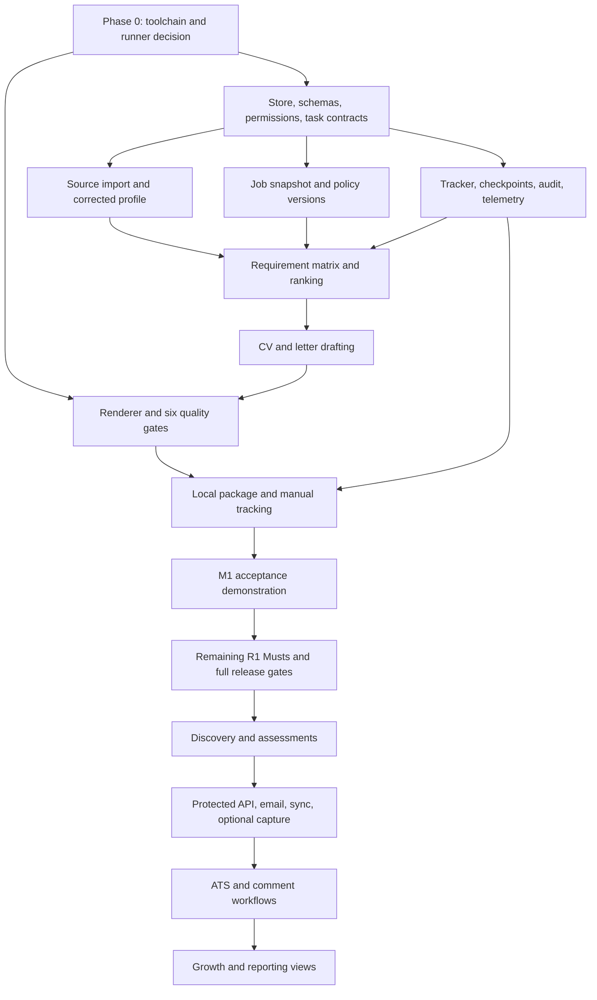

# Job workspace release dependencies and first usable milestone

Ticket: JW-01. Date: 27 October 2026. Completed specification alignment: 28 October 2026.

Status: planning deliverables complete; product implementation and runtime acceptance remain unverified.

Sources: [PRD v1.1](02-prd.md), especially sections 4, 6, 9, 11 and 12; [HLD v0.2](03-hld.md), especially sections 8, 12 and 17. The 57 original R1 Must requirements were identified in PRD v1.0; six prerequisite/packaging/telemetry requirements are now explicitly promoted to R1.

## 1. Decision and scope

Deliver one usable path first: import a candidate source, correct and publish the profile, paste a job, inspect its requirement matrix, generate and verify a CV and cover letter, export the materials, and record a manual outcome.

Call this internal milestone **M1**. M1 is part of R1, not a replacement for R1. The remaining original R1 Must requirements remain mandatory before the full R1 release. A milestone demonstration must not be described as a completed release. This avoids silently dropping CSV import, answer reuse, richer onboarding, or administrative requirements to make the first demonstration smaller.

The current checkout contains the planning documents and a LinkedIn skill bundle. Runtime implementation belongs to the separate job-workspace product identified by PRD D-01 and HLD ADR-007. This ticket changes planning documents only. It does not add a skill, modify a plugin contract, select a new model provider, or introduce another backend language.

### Recorded planning decisions

| Decision | Resolution | Consequence |
| --- | --- | --- |
| DP-01: first milestone versus release | M1 proves one end-to-end path; R1 completion adds the remaining Must scope. | Every original R1 Must has a disposition in section 4. Deferred work is visible and blocks full R1 sign-off. |
| DP-02: normalize before ranking | Move the FR-DIS-02 record contract and the minimal FR-DIS-01 import interface into R1. | Discovery pagination, history, and scheduled search remain R2. |
| DP-03: pin policies before producing artifacts | Move FR-CFG-02 policy versioning and invalidation into R1. | A ranking or manifest cannot depend on a mutable policy file. Full search controls remain R2. |
| DP-04: credibility unavailable in R1 | Preserve `unassessed`; show a review warning; allow explicit local preparation. | Do not invent `plausible`, bypass a known `blocked` state, or imply the listing was verified. |
| DP-05: minimum telemetry before dashboards | Implement the collection subset of FR-ANL-01 in R1. | Report generation and funnel dashboards stay R5. Cost may be unknown for host-mediated calls, never silently zero. |
| DP-06: browser capture follows its server | Move optional FR-CAP-01 from R2 to R3 with the local API. | R2 captures jobs through CLI URL/text/file import. No separate early capture server is added. |
| DP-07: Distilly fallback | Use the existing built-in extraction/distillation fallback when upstream integration is unavailable. | Preserve the adapter contract and evidence validation. Never report an upstream integration check as passed when it was deferred. |
| DP-08: document export before ATS | Deliver FR-DOC-11 local packaging in M1. | This is document export, not the R4 form-mapping, submission, or confirmation workflow. |
| DP-09: optional enrichment | M1 uses a fixed default claim-selection policy, no research-card enrichment, and comparable salary values only. | Optional lenses, research, and conversion do not block the first path; missing facts remain unknown or omitted. |
| DP-10: no action surface in R1 | Do not install a live email/comment/ATS executor in the R1 workflow. | Channel actions return explicit unavailable capability results. Local preparation still obeys all six document gates. |

These are delivery choices within existing product capabilities. They do not settle the separate evidence schema, authorization, scoring formula, retention, or provider feasibility questions. Those contracts must be resolved before their implementations can pass runtime acceptance.

## 2. Revised release matrix

| Stage | Included behavior | Prerequisites | Exit evidence |
| --- | --- | --- | --- |
| Phase 0 for R1 | Verify the selected local toolchain and model-runner path; decide storage and input contracts; choose Distilly fallback or verified integration. | Access to target implementation repository, supported host, render tools. | Dated decisions and reproducible checks for capabilities actually needed by R1. Unresolved later integrations are marked deferred. |
| M1, internal to R1 | Single-source onboarding; corrections; pasted/file job import; matrix and deterministic rank; CV/letter; six gates; package; manual tracking; local pause/resume; essential privacy and administration; telemetry. | R1 foundations in section 3 and M1 rows in section 4. | All section 7 scenarios demonstrated with synthetic data. No Gmail, ATS, Apify token, or upstream Distilly installation is required for this path. |
| R1 completion | Remaining onboarding formats/paths, controlled enrichment, history import, answer bank, batch behavior, full scoped administration and template registration; all original R1 Musts. | M1 plus completion rows in section 4. | Applicable PRD Must tests and NFRs pass; all six gates preserved; zero critical regression findings; recovery target and zero restricted-field leakage demonstrated. |
| R2 discovery | Search adapters, pagination, job dedup, posting-frequency coverage, credibility indicators, freshness checks, full search configuration, scheduler, local digest, portal registration. | R1; per-adapter feasibility checks. Gmail read connector only for the optional enabled email-alert source. | Labelled extraction/dedup gates, coverage-table tests, and partial-source failure reporting. Browser capture is not part of this release. |
| R3 outreach and local UI | Authorization, email, contact dedup, Gmail sync, optional referrals; local API/UI; optional quick capture. | R2; verified provider contracts; authorization, reconciliation, restore, and suppression semantics; protected API. | Duplicate-action fault tests, matching evaluation, permission checks, and capture endpoint tests. No action capability ships merely because UI work is complete. |
| R4 applications and comments | ATS adapters where verified, full manual handoff and answer mapping, confirmation handling, optional comments. | R3; verified destination capability or explicit manual fallback. | Submission evidence and ambiguous-outcome tests. Unsupported destination uses manual handoff, not a false automation success. |
| R5 growth and reporting | Interview preparation, learning plans, analytics views, calendar, HTML reports, optional one-way Notion projection. | Existing profile/tracking contracts and relevant integrations. | Usability and denominator tests; reporting uses instrumentation collected since R1. |

R2 may run career-page or permitted-feed discovery without Gmail connected in an individual workspace. A disabled alert adapter is reported as disabled. FR-DIS-05 connector implementation and fixture tests remain mandatory for full R2; disconnected workspace behavior does not remove that release obligation. Gmail outcome synchronization and sending still arrive in R3.

### Phase 0 deferral policy

An unknown dependency blocks only the feature that needs it. It may not be marked verified just to clear a gate. For each unresolved item record the owner, affected requirement, fallback, and activation test. The M1 path must have no unresolved dependency without an executable fallback.

- Distilly absent: built-in tasks with the same validated contract; no inferred behavioral assessment.
- Model API key absent: the HLD's HostAgentRunner packet/submit path, with the host's existing configured model. No assertion that processing is fully offline.
- Model runner unavailable: `blocked_input` with setup instructions; no fabricated output or skipped review.
- Render/PDF tool unavailable: `ERR_TOOLCHAIN_MISSING`; documents cannot become ready.
- Apify absent or fetch unsupported: ask for pasted text, preserve its user-supplied provenance.
- Gmail/ATS unavailable: no send or submit path is exposed in R1.

## 3. Dependency contracts required earlier

| Contract | First consumer | Original timing | Required timing and minimal boundary | Later implementation |
| --- | --- | --- | --- | --- |
| FR-DIS-01 import interface | FR-IMP-01 | R2 | R1: explicit `fetch_by_url` support or unsupported result; paste/file path always available. | R2 search, pagination, author history, conditional fetch; R4 application support. |
| FR-DIS-02 normalized record | FR-IMP-01, FR-RNK-01..04 | R2 | R1: stable source/snapshot/opportunity IDs; raw text/hash; supplied URL; retrieval time; title/company; requirements and source spans; explicit unknown fields. | R2 adapter-specific enrichment, incremental updates, and source coverage. |
| FR-DIS-06 closure status | FR-DOC-01 | R2 | R1: represent `open`, `closed`, `unverified`; paste-only imports default to `unverified`. Stop on known closed evidence. | R2 automatic re-fetch; R3/R4 re-check before actions. |
| FR-CFG-02 immutable policy | FR-RNK-02, FR-DOC-08, FR-RES-01 | R2 | R1: validate, hash, retain version, pin calculations, mark dependent rankings outdated on change. | R2 draft policy preview against prior discovery runs. |
| FR-DED-03 prior application lookup | Preparation | R1 body, R2-R3 capability map | R1: query existing local applications; require explicit prepare-anyway decision. | R2 fuzzy job merge; R3 recruiter cooldown. |
| FR-CRD-01/03 status representation | FR-RNK-01/04, FR-DOC-01 | R2 | R1: independent credibility status with truthful `unassessed` handling; no automatic credibility indicators. | R2 catalogue, expiry, assessment, overrides. |
| FR-FRQ-02/04 unavailable history | FR-RNK-04 | R2 | R1: if shown, use `unknown` with `coverage=none` and no count estimate; feature may be hidden. | R2 configured frequency filtering and verified coverage calculation. |
| FR-SAL-01 typed salary values | FR-ONB-02, FR-RNK-02 | R1 Should | R1: preserve raw value, currency, period, basis; compare only known compatible quantities. | Optional dated currency conversion; never equate CTC with base. |
| FR-CMP-01 optional company facts | FR-DOC-01/10 | R1 Should | R1: empty research input is valid; include only job identity/context supported by the snapshot. Omit independent company claims without a card. | Optional sourced card collection and expiry. |
| FR-LNS-01 default selection | FR-DOC-01 | R1 Should | R1: named, versioned default selection policy that cannot add claims. | Optional user-defined lenses and verified base CVs. |
| FR-ANL-01 event collection | DOC observability, NFR-USE-01/02, NFR-CST-01 | R5 Should | R1: step start/end, review activity/idle exclusion, task usage when available, explicit unknown cost, stable application/run IDs. | R5 aggregate dashboard and funnel reports. |
| FR-SEC-07 read connector consent | FR-DIS-05 alert adapter | R3 | R2: verify and disclose read access for enabled alert ingestion. | R3 send/draft features and other expanded scopes. |
| FR-CAP-01 server access | Quick capture | R2, API in R3 | R3: capture activates only with the protected local API. | No separate R2 server or bookmarklet token shortcut. |
| FR-NTF-01 email draft delivery | R2 digest | R2, compose in R3 | R2: local HTML/desktop delivery only. | R3 explicit permission for draft-to-self delivery. |
| FR-DOC-11 package | Candidate manually uses output | R1 Should, full handoff R4 | M1: final CV/letter in an employer-ready directory; private claim map/manifest in a separate review directory. | R4 answer sheet, form mapping, destination checklist, receipt reconciliation. |

For normalized records, absent provider IDs, contact routes, salary, seniority, or dates are represented explicitly as unavailable/unknown. Do not manufacture IDs from display names. A title or company not supplied must remain unknown; document generation asks for a required target field rather than inventing it. All known fields retain snapshot evidence and extraction confidence.

### R1 fallback behavior and user-visible results

| Situation | Required behavior | What must not happen |
| --- | --- | --- |
| Credibility engine not delivered | `unassessed`; show “Credibility has not been checked.” Rank may show fit, but its recommendation is review. Candidate may explicitly choose local preparation. | Treat unavailable assessment as plausible or automatically clear a known block. |
| Listing cannot be fetched | Use pasted text with `unverified` availability and an as-of timestamp. Require review before local preparation. | Claim the job is open because text exists. |
| Recruiter history unavailable | No history filter in M1; if displayed, unknown/no coverage. | Count missing history as zero posts or infer fraud. |
| Salary missing/incompatible | Preserve values, label salary comparison unknown, use the documented unknown score contribution. | Silent conversion, invented work hours, or CTC/base equivalence. |
| No research card | Draft using candidate evidence and job context only; omit company research claims. | Require a scraper to write a basic letter or invent company facts. |
| No style evidence | Use neutral document policy and empty observations. | Derive a personality profile or claim a personalized style was verified. |
| Unsupported action | Return unavailable capability with local export/manual-use guidance. | Report sent, submitted, confirmed, or successful simulation as a real action. |
| Required gate/tool fails | Block or pause at that gate with a recovery step. | Mark gate not applicable because an optional integration was removed. |

## 4. R1 Must requirement disposition

All 57 original R1 Must declarations and six newly promoted declarations in PRD section 6 appear below (63 total). “M1 reduced” is a milestone boundary, not fulfillment of the full requirement. Every reduction lists the R1 completion obligation. Prerequisites name contracts available earlier in M1 or before R1 completion; no row requires a live R2-R5 integration.

| Requirement | Delivery | Prerequisites | M1 behavior or remaining R1 completion obligation |
| --- | --- | --- | --- |
| FR-PRF-01 | M1 | Local store, projection templates | Canonical profile; generated projections; manual-edit detection; recoverable publish. |
| FR-PRF-02 | M1 | Claim and disclosure policy | Validate claim class and permitted use; preserve unknown and restricted semantics. |
| FR-PRF-03 | M1 | Parsed source spans | Stable source hashes and locators; validate citations and claim support. |
| FR-PRF-04 | M1 | Version store, dependency records | Pin inputs; invalidate affected drafts and derived outputs. |
| FR-PRF-05 | M1 | Claims, field rules | Surface conflicts; block publication for required conflicting fields. |
| FR-PRF-06 | M1 | Claim history | Explicit correction and supersession; no silent source overwrite. |
| FR-PRF-07 | M1 | Source/dependency store, deletion protocol | Preview revocation impact; remove active use; purge per retention contract. |
| FR-PRF-09 | M1 | Schema and packet policies | No recruiter trait fields or inferred characteristics. |
| FR-PRF-10 | M1 | Published profile, disclosure policy | JSON/Markdown export; raw sources only on explicit inclusion. |
| FR-PRF-11 | M1 | Dates, confirmed intervals | Relevant non-overlapping experience with calculation date and conservative precision. |
| FR-DST-01 | M1 | ModelRunner, evidence validator | Built-in adapter fallback; valid observations or insufficient-material result; candidate accepts changes. |
| FR-DST-02 | M1 | Phase 0 decision, task versions | Pin the chosen fallback implementation; show upstream integration unavailable until verified. Upstream upgrade tests apply when enabled. |
| FR-ONB-01 | M1 reduced | Parser, profile, corrections | Single text-readable CV path in M1. Folder, interview, OCR, and every declared supported import format must pass by R1 completion. |
| FR-ONB-02 | M1 | Field schema, sensitivity policy | Support declared profile fields; only ask required missing data; optional sensitive fields are not forced. |
| FR-ONB-03 | M1 | Validation functions | Dates, contacts, URLs and aliases validated; warn versus reject as specified. |
| FR-ONB-04 | R1 completion | Fetch guard, diff review | M1 corrections remain available. Complete approved-source enrichment and remembered rejection before full R1. |
| FR-ONB-05 | M1 | Evidence validator, model contracts | Missing facts remain unknown; ask or omit. |
| FR-ONB-06 | R1 completion | Tracker, CSV fidelity contract | M1 begins with an empty tracker. Historical import and round-trip acceptance remain release blockers. |
| FR-CFG-01 | M1 core | Versioned policy schema | Validate preparation/ranking fields and channel-disabled defaults. R2-only configuration cannot activate unavailable features. |
| FR-IMP-01 | M1 reduced | DIS-01/02 import contracts, fetch guard | Paste and file ingestion; URL may return NEEDS_PASTE. Verified optional URL fetching completes the full supported R1 import contract. |
| FR-DED-03 | M1 | Local tracker, normalized identity | Prior application warning and recorded explicit prepare-anyway decision. |
| FR-RNK-01 | M1 | Profile, policy, normalized job | Apply supported hard constraints; unknown is not a match; credibility unavailable stays unassessed. |
| FR-RNK-02 | M1 | Versioned score formulas | Deterministic score with unknown contributions and compatible salary comparisons. |
| FR-RNK-03 | M1 | Claims, requirements, mapping task | Supported/partial/unsupported/unknown mapping with evidence; transferable is not direct support. |
| FR-RNK-04 | M1 | Score and status representations | Explained shortlist; missing assessments force review recommendation, not automatic preparation. |
| FR-DOC-01 | M1 reduced | Profile/job/policy pins, matrix, runner | One job, CV and letter. Batch and structured-answer preparation complete in R1; email/comment outputs remain R3/R4. |
| FR-DOC-02 | M1 | Selected renderer, fixture, sandbox | One pinned starter template with licensed fonts and explicit constraints. |
| FR-DOC-03 | M1 | Renderer, raster/layout tools | Render and visual check always required. |
| FR-DOC-04 | M1 | Text extraction, field/evidence checks | Text checks always required, including target and contact correctness. |
| FR-DOC-05 | M1 | Relevance ordering, protected fields | Page fit without unsafe font reduction or silent role deletion; block impossible fit. |
| FR-DOC-06 | M1 | Isolated review packet, model runner | Independent-context review; critical and major findings block. |
| FR-DOC-07 | M1 | Gate results, repair task | Bounded repair and required rechecks; exhaustion blocks readiness. |
| FR-DOC-08 | M1 | Immutable artifacts, version pins | Manifest records every gate and output hash; no skipped gate recorded as passed. |
| FR-DOC-10 | M1 | Style policy, optional research input | Length and evidence rules; no independent company claims without sourced card facts. |
| FR-TRK-01 | M1 | Event store and reducer | Preparation, channel and outcome states separate; inactive channels have no invented receipts. |
| FR-TRK-02 | M1 | Outcome events, evidence fields | Candidate-reported outcomes labelled as such; no inferred provider confirmation. |
| FR-TRK-03 | M1 reduced | Tracker projection | Current tracker view and CSV export in M1; imported-column preservation completes with ONB-06. |
| FR-RES-01 | M1 | Durable local run/task store | Checkpoints, pins, completed/pending tasks, concise decisions; no hidden reasoning. |
| FR-RES-02 | M1 | Persistent stop flag | Pause new work; checkpoint completed local units. |
| FR-RES-03 | M1 reduced | Ownership, pinned task state | Resume local tasks; external reconciliation is unavailable until actions exist. R3 must add its action-specific proof before sending. |
| FR-RES-04 | M1 | Typed failure results | Model quota, malformed outputs, local/network failures handled; disabled providers cannot silently run. |
| FR-RES-06 | M1 | Run and capability state | Show blocked, stale, quota and unavailable features with next safe step. |
| FR-ADM-01 | M1 reduced | Preview, backup, deletion protocol | Implement reset for M1-owned data; complete all declared scopes by R1. Unknown or unavailable scopes cannot report successful deletion. |
| FR-ADM-03 | M1 | Local store/artifact snapshots | Backup/restore with schema checks and deletion policy; no active action credentials included. |
| FR-ADM-05 | R1 completion | Command interface, legacy inventory | Preserve legacy rules in M1 design; complete thin adapter and supported import mapping for full R1. |
| FR-ADM-06 | R1 completion | Template contract and gates | M1 uses validated bundled template. User template registration must pass all gates before full R1. |
| FR-SEC-01 | M1 | Packet/tool boundaries | Imported content cannot grant permissions or choose new recipients. |
| FR-SEC-02 | M1 | Synthetic adversarial fixtures | Injection cannot alter scores, data authority, artifacts or action permissions. |
| FR-SEC-03 | M1 | Credential store and redaction | No secrets in packets, logs, manifests or backups. |
| FR-SEC-04 | M1 | URL resolver and fetch boundary | Enforce fetch limits before any optional URL path; paste fallback remains available. |
| FR-SEC-05 | M1 | Renderer sandbox | No shell escape/network or access outside build inputs. |
| FR-SEC-06 | M1 reduced | Parser limits and format allowlist | Bound M1 inputs; unsupported formats rejected. Archive/OCR support adds required safety tests before being enabled in R1 completion. |
| FR-SEC-08 | M1 | Append-only audit events | Audit edits, overrides, deletions, preparation and manual outcomes. No fictitious action audit entries. |
| FR-ANS-01 | R1 completion | Claim references, answer schema | M1 asks profile facts through correction UI; persistent reusable answers added before full R1. |
| FR-ANS-02 | R1 completion | Meaning/unit/sensitivity rules | No implicit answer reuse in M1; full context checks required for answer bank release. |
| FR-ANS-03 | R1 completion | Batch preparation and answer store | M1 single-job prompts; unknown-question batching completed before full R1. |
| FR-SIM-01 | M1 reduced | Explicit execution mode | Simulate enabled local workflow; unsupported actions remain unavailable. Each later action adapter must add simulation tests before activation. |
| FR-CFG-02 | M1 | Validated policy schema and version store | Pin immutable policies for ranking and manifests; invalidate dependent rankings after changes. R2 search reuses the contract. |
| FR-DIS-01 | M1 core | Capability registry and import paths | Explicit supported/unsupported URL import; paste fallback. Search/history/pagination remain R2. |
| FR-DIS-02 | M1 core | Snapshot/evidence store | Normalized records for paste/file jobs before ranking; unknown fields remain unknown. Adapter enrichment remains R2. |
| FR-DIS-06 | M1 core | Listing availability field and source time | Known closed blocks; unverified requires review. Automatic re-fetch remains R2 and execution re-checks arrive with actions. |
| FR-DOC-11 | M1 | Ready manifest and artifact hashes | Separate employer-ready CV/letter from private claim map/manifest; no submitted outcome from export. R4 retains form workflow. |
| FR-ANL-01 | M1 core | Run/application IDs and task events | Collect timings, review activity and available usage; unknown cost explicit. Reports remain R5. |

### Should/Could and NFR handling

Full R1 retains its original Must obligations. Optional features have explicit dispositions: LNS, SAL conversion, CMP collection, calibration, presets, comparison UI, automatic upstream checks, and profile-age banners are outside M1. They can be added for R1 if ready; omission must be reported as omitted, not passed. FR-DOC-11 packaging is promoted to M1 because manual use is the milestone outcome. FR-ONB-07 is needed only for accepting edited projections; until implemented, detection blocks overwrite and gives the user a correction path through canonical profile commands.

The PRD's platform, accessibility, performance, privacy, truthfulness, and recovery targets still govern the release. M1 can be demonstrated on the initial verified platform, but that does not satisfy the Windows/macOS/Linux release matrix. All three platforms must pass before full R1 is labelled portable. CLI plus generated HTML are read-only review views in R1-R2; mutating operations use the CLI until R3. Empty/unknown metrics are explicit, and no causal success claim follows from the demonstration.

## 5. Dependency graph and implementation ownership

| Workstream | Primary owner | Integrates after | Required deliverable |
| --- | --- | --- | --- |
| Foundations | Agent developer | Phase 0 decisions | Canonical schemas/store, task interface, version pinning, packet policies, disabled action capabilities. |
| Candidate evidence | AI developer with agent developer | Source/claim schema | Extraction and correction flow, supported claims, rejection cases, restricted-data tests. |
| Import and scoring | AI developer with agent developer | Normalized job and policy contracts | Evidence mapping, deterministic arithmetic, missing-data and prior-application behavior. |
| Documents | AI developer with agent developer | Profile/matrix/template contracts | Draft, fit, render, review, bounded repair, immutable manifest. |
| Local lifecycle | Agent developer | Store and artifact contracts | Checkpoint/replay, export, backup/restore, deletion, manual tracking and telemetry. |
| Acceptance | QA/reviewer | Complete M1 path | Synthetic workflow evidence and explicit remaining R1 blockers. |

Schema design and fixtures can run in parallel after shared interfaces are agreed. Do not implement an API, distributed queue, or remote scheduler to complete this planning ticket. Durable local tasks and the existing HLD ModelRunner port are sufficient design boundaries.

## 6. Ordered first-milestone checklist

1. Inventory the implementation repository and record the initial supported host. Pin the renderer/PDF tools and choose HostAgentRunner or a verified API runner. Demonstrate the chosen path can return a validated task result.
2. Define claim, source-span, job-snapshot, policy, task, artifact, manifest, and outcome records. Set explicit disclosure and untrusted-content rules before model calls.
3. Implement the local store, immutable artifact paths, versioning, audit events and checkpoint ownership. Add minimum timing/usage events now.
4. Implement one readable CV import and the correction screen/CLI. Publish a profile only after required conflicts are resolved. Keep source evidence and candidate confirmation distinct.
5. Implement pasted/file job import through the normalized record contract. Show unknown fields and listing status. Add immutable policy versions and prior-application lookup.
6. Implement requirement-to-evidence mapping and deterministic score arithmetic. Explain unknown contributions and keep unassessed credibility visible.
7. Register one validated starter template. Generate CV and cover letter using candidate evidence and job context, without requiring research-card collection or custom lenses.
8. Implement all six document gates, isolated review and bounded repair. Persist successful step outputs so a review interruption does not repeat drafting.
9. Export a local package separating employer-ready files from the private claim map and manifest. Record manual outcomes with their evidence status; no provider confirmation is inferred from export.
10. Complete pause/resume, source revocation, essential reset and backup/restore behavior for the M1 data model. Test missing dependencies, quota interruption and stale-input invalidation.
11. Run the scenarios below and report actual results. Mark unavailable features unavailable. List all R1-completion rows still outstanding before making any release claim.

## 7. M1 runtime acceptance scenarios

These are implementation acceptance specifications, not tests claimed to have run in this documentation change.

| Scenario ID | Setup and action | Required result |
| --- | --- | --- |
| M1-01: clean start | New workspace, synthetic readable CV, pasted job; no Gmail/ATS/Apify credentials or upstream Distilly install. Use the configured host model runner. | Publish profile, rank, generate CV/letter, complete all six gates, export and record a manual outcome. Zero email/comment/ATS calls. |
| M1-02: evidence and conflict | Source dates conflict; candidate corrects them. Draft contains a seeded unsupported qualification. | Publication waits for required correction; unsupported qualification blocks readiness until repaired or removed. |
| M1-03: unavailable assessments | Import a job that cannot be fetched; no credibility/history service. | Availability unverified, credibility unassessed, history unknown if shown. Recommendation is review; explicit local preparation allowed with warning. |
| M1-04: no enrichment | No lens configuration, style observations or company research card; salary bases incompatible. | Default selection and neutral style work; no unsupported company statement; salary comparison unknown. All six gates still run. |
| M1-05: interrupted review | Stop after draft and render complete, before review output is committed; resume. | Completed outputs retained; review reruns safely; no duplicate logical application or invented successful gate. |
| M1-06: correction after readiness | Correct contact or a cited employment field, then request package. | Affected artifact becomes stale and cannot be exported as current ready material until regeneration passes gates. Unaffected artifacts remain valid per dependency contract. |
| M1-07: model quota/tool absence | Exhaust quota during review; separately remove the renderer from a test environment. | Pause with next safe step for quota; explicit toolchain error for renderer. Neither document becomes ready. |
| M1-08: prior application | Prepare the same employer/requisition already in local history. | Existing application shown; no new preparation until explicit prepare-anyway decision. |
| M1-09: privacy/export | Include a restricted fixture value and attempt instruction injection in source text. Export package. | Forbidden data absent from model packets and employer-ready files; no changed authority or action destination; private review material clearly separate. |
| M1-10: deletion and restore | Revoke a source, preview impact, confirm deletion, then exercise restore in a separate test workspace. | Active use stops; affected drafts stale; retention and restored deletion behavior match the defined contract. |
| M1-11: telemetry | Perform a preparation with an idle review interval and unavailable API billing data. | Active/elapsed time separated; idle handling recorded; unavailable cost explicitly unknown; events tied to application/run IDs. |
| M1-12: capability honesty | Request send, ATS submit, capture endpoint or scheduled search in M1. | Explicit unavailable feature result. No fake receipt, automatic permission grant, live connector invocation, or real-success counter increment. |

The full R1 gate additionally requires every R1-completion row, all declared input formats and setup paths, validated answer reuse, history import/export, template registration, supported platform matrix, and the PRD's applicable NFRs. M1 results cannot substitute for these checks.

## 8. Planning acceptance and handoff

| JW-01 planning acceptance | Evidence in this document | Runtime status |
| --- | --- | --- |
| Every R1 Must has an available prerequisite or a declared reduced milestone behavior | Section 4 maps all 63 current requirements and preserves completion obligations. Section 3 moves shared prerequisites earlier. | Not implemented by this ticket. |
| No unavailable capability is reported as passed | Section 3 fallback table and M1-03/M1-12 define exact behavior. | Requires runtime verification. |
| Clean-install core path needs no Gmail or ATS integration | Sections 2 and 6 define the model/renderer prerequisites; M1-01 specifies acceptance. | Requires runtime verification. |
| Optional enrichment cannot bypass truthfulness gates | DP-09, fallback table and M1-04 preserve all six gates. | Requires runtime verification. |
| Revised releases, dependency graph, decisions and numbered milestone checklist delivered | Sections 1, 2, 5 and 6. | Documentation complete. |

Stop condition for JW-01: the PRD and HLD link to this delivery baseline, all original R1 Musts have a mapped disposition, and the document consistency check passes. Implementing the application, provider probes, or remaining review tickets is separate work. No release or runtime readiness is claimed here.

### Reproducible specification check

Run `python tools/check_release_plan.py` from the repository root. It checks coverage and uniqueness of R1 Must dispositions, requirement references, promoted release assignments, capture timing, and the M1 checklist/scenario inventory. It validates the specification only; it cannot prove that a clean installation already runs the workflow. Runtime scenarios M1-01..12 remain the implementation team's release evidence.
