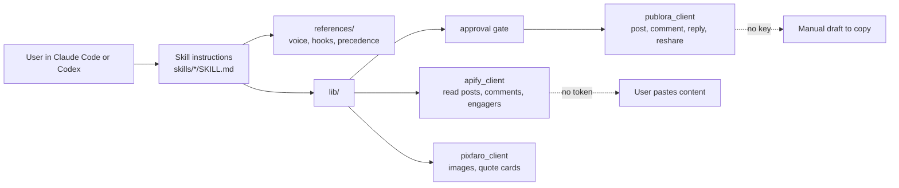
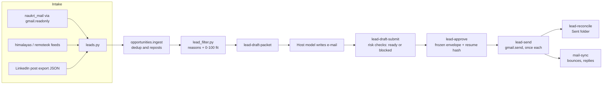
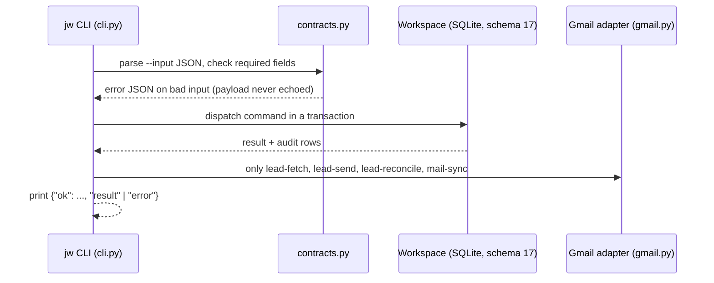

# Architecture

Part of the product analysis. Index: [docs/product/README.md](README.md). Status labels: **Implemented** (code and tests in the repo), **Planned** (documented, no code), **Unsupported** (refused on purpose), **Needs Verification** (not proven by a local check).

### 6.1 linkedin-skills

### 6.2 jw lead pipeline

### 6.3 jw command path

Deeper design: [HLD](../../docs/architecture/HLD.md), [LLD](../../docs/architecture/LLD.md),
[database](../../docs/architecture/DATABASE_DESIGN.md), [data flow](../../docs/architecture/DATA_FLOW.md),
[security and privacy](../../docs/architecture/SECURITY_AND_PRIVACY.md).
