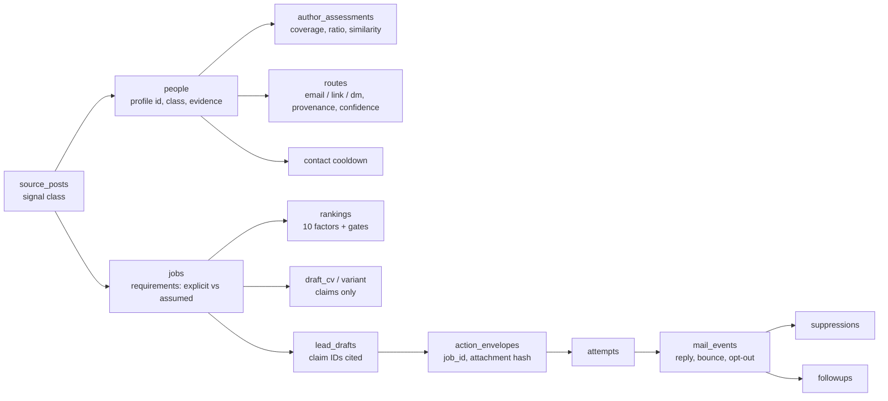

# groundwork-jobs: strategic product audit

Date: 2026-11-26. Scope: `jw` (`src/jw/`), its docs, and the `linkedin-skills` bundle only where
it touches the job pipeline. Base commit: `7ea831d` (v1.1.90). Read-only audit: no code was
changed while it was written.

**How to read this.** Every claim about the product is tied to a file and line. Anything not
verified in this repository is labelled **Hypothesis**. No competitor is named and no market size
is stated, because none was measured. Legal remarks are risk flags, not legal advice.

Priority scale: **P0** = do now (causes harm or blocks all value), **P1** = within 60 days,
**P2** = within 90 days, **P3** = later or only if data supports it. Complexity: **S** ≤ 1 day,
**M** 2-5 days, **L** 1-3 weeks, **XL** more.

---

## 1. Executive assessment

**Verdict: jw is an excellent send pipe bolted to the wrong funnel.** The safety engineering
(send-once, crash recovery, fencing tokens, suppression journal, claim-to-evidence gates) is far
ahead of what most personal tools ever reach. The part that decides whether you get interviews
(who you write to, why them, what you attach and whether it worked) is thin, partly
contradicts your vision, and cannot measure itself.

Five uncomfortable truths:

1. **The intake rule selects against your target person.** A LinkedIn post becomes a lead only
   if its text contains an e-mail address (`src/jw/leads.py:107-109`), and the search queries
   append "hiring share resume" (`src/jw/search_terms.py:43`). That is the exact language of
   high-volume recruiters and agencies, not of founders and engineering managers who post
   occasionally. Your own live run shows it: of 1,224 exported posts with an e-mail, 439 (36%)
   were reposts of the same contact and role (`docs/implementation/LEAD_PIPELINE.md:41`).
   **Hypothesis**: the founder or EM you want usually writes "DM me" or links a careers page and
   is dropped as `unparsed` today.
2. **The funnel yield is about 0.1%.** 2,000 LinkedIn posts produced 2 ready drafts:
   904 opportunities, 8 kept by `lead-filter`, 4 after manual review, 2 ready
   (`LEAD_PIPELINE.md:37-46`, `:60-62`, `:80-85`). The machine spends most of its effort
   discarding noise it chose to collect.
3. **The fit score is degenerate.** With the default policy, the "60% skill overlap" compares
   the candidate's skill list with itself (`src/jw/lead_filter.py:57-61`), so overlap is 1.0 if
   any listed skill appears and 0 otherwise. Verified in this audit: a post asking "Java" only, a
   post asking eight matching skills, and a post asking Java plus six skills the candidate lacks
   all score **100**. The ranking you see is not a ranking.
4. **The "never invent" promise has a hole.** The draft checker only knows 35 technologies
   (`src/jw/lead_filter.py:36-39`, used at `src/jw/lead_drafts.py:62`). Verified in this audit:
   an e-mail claiming Kubernetes, GraphQL and Terraform (absent from the facts), calling the
   sender "the perfect candidate" and ending "Please find my resume attached" is marked
   **ready**. The README says it blocks "a technology your facts do not list"
   (`README.md:223`); that is true only for the 35 listed terms.
5. **You are flying blind.** `lead-approve` creates envelopes without a `job_id`
   (`src/jw/lead_queue.py:64`), so replies, bounces and opt-outs to lead e-mails never attach to
   anything (`src/jw/mailsync.py:130-140`, `:158-162`), follow-ups cannot be scheduled, and the
   reply-rate metric counts only `jobs` rows (`src/jw/metrics.py:35-40`). While e-mails are being
   sent right now, nothing in jw can tell you which ones worked.

**What to do.** Stop adding sources. Make the **hiring person** the unit of the product, connect
the lead pipeline to the evidence workspace that already exists (one missing `job_id` unlocks
suppression, follow-ups, reply matching and metrics), and judge every change by human replies.
Section 20 states the single change; section 18 sequences it.

Vision coverage today:

| Vision stage | State | One-line reason |
| --- | --- | --- |
| 1. Hiring signals | Partial | Title keyword cards and an e-mail-in-text rule; no content, ratio or authenticity analysis |
| 2. The person | Missing | Only the author display name is stored (`leads.py:119`); no profile, role, classification or ranking |
| 3. Contact | Partial | First e-mail in the post (`leads.py:119`); no source record, confidence or address classification |
| 4. The opportunity | Partial | Regex title, years and India location; no explicit-vs-assumed split |
| 5. Tailored resume | Exists, disconnected | Evidence-gated CV generation exists (`tasks.py`) but leads send one fixed PDF |
| 6. Personal e-mail | Partial, conflicting | Checker forces a "resume attached" line and misses the vision's banned phrases |
| 7. Approval and tracking | Partial | Batch approval by draft ID in JSON; replies, bounces, opt-outs and follow-ups not linked |

---

## 2. What the product does now

### 2.1 Capability audit

Classification: **Full** = implemented and tested; **Partial** = implemented with material gaps;
**Doc only** = documented, no code; **Missing** = neither; **Questionable** = possible but
commercially or legally doubtful.

| Capability | Class | Evidence |
| --- | --- | --- |
| LinkedIn post import from a JSON export | Full | `leads.py:104-120`, `cli.py:265-268`; tests `tests/test_jw_leads.py` |
| Bulk LinkedIn export via Apify search actors | Questionable | Run live 2026-11-07 (`LEAD_PIPELINE.md:41`); no code in jw; platform-terms risk (section 10.5) |
| Export from "a paced signed-in browser session" | Questionable | `LEAD_PIPELINE.md:23`, `leads.py:4-5`; risks the candidate's own account |
| Single post fetch by URL | Full (other product) | `lib/apify_client.py:106-138`; not wired into jw, user pastes text (`README.md:176-177`) |
| RemoteOK / Himalayas feeds | Full | `leads.py:123-144`, `:221-236`; never yield a contact (`README.md:54-55`) |
| Naukri invite parsing from Gmail | Partial | `leads.py:70-101`, `:200-218`; never run live (`LEAD_PIPELINE.md:45-46`) |
| Dedup and repost folding | Full | `opportunities.py` (JW-21); lead rule `leads.py:151-159` |
| Filters with reason codes | Full | `lead_filter.py:68-131` |
| Filter policy per candidate | Partial | Skills, exclusions, India rule and abroad list are hard-coded (`lead_filter.py:25-40`, `leads.py:22-24`) |
| Poster frequency check | Partial | Counts by display name, only posts this workspace saw, reposts excluded (`lead_filter.py:79-84`, `leads.py:176-180`) |
| Lead fit score | Partial (degenerate) | `lead_filter.py:57-65`; see section 1 point 3 |
| Explainable ranking engine (weights@1) | Full, unused by leads | `ranking.py:143-210`, `policy.py:16`, `docs/architecture/SCORING.md` |
| Credibility / scam assessment | Doc only | PRD FR-CRD-01..05 (`docs/02-prd.md:889-924`); `CREDIBILITY_BLOCKED` unreachable (`IMPLEMENTATION_STATUS.md:18`) |
| Author history (posting cadence) | Doc only | PRD `author_history` (`02-prd.md:734`, `:885`); no adapter in `lib/apify_client.py` |
| Person profile, role classification, ranking | Missing | No table or code |
| Contact source, confidence, address class | Doc only | PRD FR-EML-01 (`02-prd.md:1200-1207`); code takes `emails[0]` (`leads.py:119`) |
| Contact discovery beyond the post text | Missing | By design (`README.md:59-63`) |
| Requirement extraction (explicit vs assumed) | Missing for leads | Regex years only (`leads.py:21`, `:33-40`); title falls back to "Software Developer" (`leads.py:116`) |
| E-mail drafting packet and checker | Partial | `lead_drafts.py:48-81`; gaps in section 12 |
| Candidate evidence registry with provenance | Full | `workspace.py`, `privacy.py` (JW-03, JW-04) |
| Paraphrase guard and approval | Full | `semantics.py:1-7` (lexical, not semantic) |
| Evidence-gated tailored CV (`draft_cv`) | Full, not ready-exportable | Every assertion must be exact claim text or an approved paraphrase (`tasks.py:228-245`); PDF watermarked `PRIVATE DRAFT - NOT READY` (`rendering.py:32`); `ready` is always `False` (`verification.py:239`) |
| Tailored CV attached to lead e-mails | Missing | One resume per approval batch and per send call (`lead_queue.py:47`, `:81`, `:98`) |
| Batch approval with frozen content and resume hash | Full | `lead_queue.py:43-73`, `actions.py:71-104` |
| Send once, lost response never resent | Full (demo transport) | `lead_queue.py:76-107`, `execution.py:86-110`; jw's own send path never qualified live (`IMPLEMENTATION_STATUS.md:13`) |
| Reconcile unknown sends from Sent | Full (demo transport) | `lead_queue.py:110-134` |
| Daily caps and allowed hours | Partial | Skipped when no `schedule-set` policy exists (`schedule.py:88-92`) |
| Reply / bounce / opt-out handling for lead e-mails | Missing in effect | Needs a `job_id`; lead envelopes have none (`lead_queue.py:64`, `mailsync.py:130-140`) |
| Manual suppression | Full | `suppress` command (`cli.py:77`, `:295-297`); checked at send (`execution.py:99`) |
| Duplicate outreach to the same person across posts | Missing | Only same content + same address is refused (`lead_queue.py:33-40`, `:59-60`); PRD cooldown FR-DED-02 not built (`IMPLEMENTATION_STATUS.md:32`) |
| Follow-ups | Missing in effect | `Followups.schedule` is called only from tests (`IMPLEMENTATION_STATUS.md:26`) |
| Approval preview (post, person, contact, CV, e-mail) | Missing | CLI JSON only; loopback API exists without UI (`api.py`, JW-17) |
| Metrics for lead outreach | Missing | Metrics are per `jobs` row (`metrics.py:35-46`) |
| Dashboard (phase 5), daily run (phase 6) | Doc only | `LEAD_PIPELINE.md:13-14` |
| Revoked Gmail token handling | Partial | `GmailError` is not a `WorkspaceError` (`gmail.py:46`), raised at transport build (`gmail.py:482-494`); CLI catches neither (`cli.py:384-390`), so a traceback |
| Feed fetch URL safety | Partial | `urlopen` without `check_url` (`leads.py:232`) |

### 2.2 Contradictions between vision, README, docs and code

| # | Contradiction | Where |
| --- | --- | --- |
| C1 | Poster frequency: **vision** wants authors posting 3-4 times a **week**; **PRD** prefers at most 2 hiring posts a **month**; **code** drops authors with more than 4 posts seen in 30 days | Vision brief; `02-prd.md:842`; `lead_filter.py:40`, `:112-113` |
| C2 | PRD says name-only identity "cannot push a count over the limit"; code counts by display name and drops on it | `02-prd.md:860`; `lead_filter.py:83`, `:112` |
| C3 | Vision bans "Please find my resume attached"; the standard and checker require a resume-attached line | `lead_drafts.py:30-34`, `:75`; `README.md:210`, `:227` |
| C4 | Vision bans "I am writing to express my interest" and "perfect candidate"; neither is in `BANNED` | `lead_drafts.py:23-26` |
| C5 | README: checker blocks "a technology your facts do not list"; code checks only 35 terms | `README.md:223`; `lead_drafts.py:62` |
| C6 | Vision Stage 2 profiles the person (background, history, style); PRD anti-persona says "No recruiter profiling; frequency data limited to counts and post IDs" | `02-prd.md:140-144` |
| C7 | Vision Stage 5 attaches a tailored resume; README and code attach one fixed resume | `README.md:136-137`; `lead_queue.py:47`, `:81` |
| C8 | PRD problem #1 is "no single source of truth"; the repo now has three candidate fact stores: the claims registry, a free-text facts file for lead e-mails, and `references/story-bank.md` from `linkedin-interviewer` | `02-prd.md:72`; `lead_drafts.py:43-45`; `SKILL.md:23` |
| C9 | Two scoring systems: `ranking.py` (8 weighted components, confidence, explanations) and `lead_filter.fit` (60/20/20, degenerate) | `ranking.py:143-210`; `lead_filter.py:57-65` |
| C10 | Experience limit: LEAD_PIPELINE says "minimum years asked ≤ 4" in one place and "defaults to 5" in another; code is 5 | `LEAD_PIPELINE.md:51`, `:67`; `lead_filter.py:40` |
| C11 | `status` reports `send: unsupported` and CLI help says "no external actions" while `lead-send` sends | `workspace.py:657-658`; `cli.py:321` |
| C12 | FEATURES.md says IMPLEMENTATION_STATUS "states the checkpoint is partial, not M1 or R1"; IMPLEMENTATION_STATUS now opens "All 25 tickets are implemented and verified" | `docs/product/FEATURES.md:66-67`; `IMPLEMENTATION_STATUS.md:3` |
| C13 | README lists Naukri mail as a "Priority 1" source; it has never run live | `README.md:56`; `LEAD_PIPELINE.md:45` |
| C14 | The vision says "stop chasing job ads"; two of four sources are job-ad feeds and the third is job-board invites | `README.md:52-57` |
| C15 | jw-only doc commits bump the `linkedin-skills` plugin version (v1.1.88-1.1.90) | `git log`; `.claude-plugin/plugin.json` |
| C16 | PRD subject `<Role> — <Name>` and file name `<Candidate>_<DocType>_<Company>.pdf`; code sends the resume under its local file name | `02-prd.md:1209`, `:1225`; `lead_queue.py:26` |

### 2.3 Test status in this audit

The 96 tests of the lead modules and their core dependencies pass (`test_jw_leads`,
`test_jw_lead_filter`, `test_jw_lead_drafts`, `test_jw_lead_queue`, `test_jw_search_terms`,
`test_jw_mailsync`, `test_jw_suppression`, `test_jw_ranking`, `test_jw_semantics`,
`test_jw_schedule`). The full suite under the system Python ran 478 tests with 58 failures and
errors; the ones inspected trace to modules not installed here (`reportlab`, `pypdf`, `requests`,
`yaml`). The documented 562-test green run (`docs/product/EXECUTIVE_SUMMARY.md:9`) needs the dev
and render extras and was not reproduced. Behaviour evals cover only the LinkedIn skills; there is
no eval for jw e-mail drafting (`python3 evals/run_evals.py --list`).

---

## 3. What it should become

**Positioning:** a private hiring-person desk for one serious candidate. Each day it finds a
handful of people who personally own an open hiring need, shows who they are and how it knows,
finds a contact route they published, prepares an application that every line of which the
candidate can defend, sends only what the candidate approves, and learns from who replies.

What changes in kind:

| From | To |
| --- | --- |
| Lead = post that contains an e-mail | Lead = person with a hiring need, plus every route to reach them (e-mail, apply link, DM) |
| Volume in, filters out | Precision in: person-first queries and author assessment before parsing |
| One resume for every send | A small library of pre-verified resume variants, per-lead tailoring for the top leads |
| Score = keyword overlap | Score = explainable 10-factor model with confidence, learned from replies |
| Sent = done | Sent → replied / bounced / silent → one follow-up → outcome, per person |
| Facts file + claims + story bank | One evidence registry the e-mail, CV and posts all draw from |

What it must **not** become: an auto-apply bot, a bulk sender, an e-mail guesser or a recruiter
database. Those destroy the channel the product depends on (section 14).

| ID | Recommendation | Problem solved | Commercial reason | Expected impact | Complexity | Priority | Success metric |
| --- | --- | --- | --- | --- | --- | --- | --- |
| R3.1 | Adopt "hiring person" as the core record and rename the pipeline around it (person, signal, route, application) | Product optimises the wrong unit (posts with e-mails) | Interviews come from people, not posts | Aligns every later feature | M | P1 | Share of sends to people classified `hiring_owner` or `in_house_recruiter` ≥ 70% |
| R3.2 | Treat the product as a personal power tool until it proves an interview rate on 100+ sends | Premature productisation | Productising before proof wastes effort and invites platform risk | Focus | S | P0 | Decision memo after 100 measured sends |

---

## 4. Biggest vision-versus-implementation gaps

Ranked by effect on interviews.

| Rank | Gap | Evidence | Consequence |
| --- | --- | --- | --- |
| G1 | No outcome loop for lead e-mails | `lead_queue.py:64`; `mailsync.py:130-140`; `metrics.py:35-40` | Cannot tell what works; opt-outs and bounces are not suppressed, so a person who said "remove me" can be e-mailed again from another post |
| G2 | Intake selects for e-mail-in-text posts | `leads.py:107-109`; `search_terms.py:43` | Bias toward ad-stream recruiters; vision's target persona filtered out (**Hypothesis**, supported by 36% repost rate) |
| G3 | No person layer | `leads.py:119` stores display name only | Cannot classify founder vs agency, cannot rank people, cannot dedup by person |
| G4 | Degenerate fit score | `lead_filter.py:57-61` | Ordering is near-random among survivors |
| G5 | Checker misses unlisted technologies and vision-banned phrases | `lead_drafts.py:23-26`, `:62` | False claims and stock phrasing can reach "ready" |
| G6 | One fixed resume | `lead_queue.py:47`, `:81` | Vision Stage 5 not delivered although the CV engine exists |
| G7 | No duplicate-person guard | `lead_queue.py:33-40` | Same recruiter can get several e-mails for several posts |
| G8 | Candidate-specific values in source code | `lead_filter.py:25-40`; `lead_drafts.py:30-34` ("about 3 years of full stack work") | Not reusable; every profile change is a code change; facts can drift from code |
| G9 | No review screen | CLI JSON | Approval of 10+ drafts is error-prone; vision Stage 7 needs a side-by-side view |
| G10 | Caps off by default | `schedule.py:88-92` | One mistaken command can send up to 100 e-mails per call (`lead_queue.py:80`) with no daily ceiling |

---

## 5. Recruitment market analysis

Facts from this repository are marked **Observed**. Everything else is **Hypothesis**; none of it
was measured for this audit.

**5.1 Channel structure.**

| Channel | How a candidate enters | Who reads first | Notes |
| --- | --- | --- | --- |
| Job boards and one-click apply | Form or profile | ATS rules, then a recruiter | **Hypothesis**: highest competition per role; easiest to automate, so most automated |
| Job-board recruiter invites (Naukri mail) | Invite e-mail | Same as above | **Observed**: parser exists, never run live |
| Remote job feeds | Apply link | ATS or founder | **Observed**: most remote roles are not open to India; location dropped 592 of 904 opportunities (65%) in the live run |
| Recruiter posts with "share CV at" e-mail | E-mail | Recruiter inbox, often shared | **Observed**: 61% of 2,000 exported LinkedIn posts carried an e-mail; 36% of those were reposts |
| Hiring-manager or founder posts | DM, comment, careers link, sometimes e-mail | The decision maker | **Hypothesis**: fewer applicants, higher reply value, rarely an e-mail in text |
| Referral | Employee | Hiring manager | **Hypothesis**: strongest channel, outside this product today |

**5.2 Dynamics that matter for this product.**

- **Hypothesis: the direct channel is valuable because it is scarce.** As AI makes tailored
  mass e-mail cheap, hiring people will receive more of it and filter harder. Restraint,
  specificity and verifiable claims become the differentiator, not throughput.
- **Hypothesis: in Indian tech hiring for 0-6 years of experience, a large share of public
  hiring posts come from agencies and staffing firms.** The 36% repost rate is consistent with
  this but does not prove it. Measure it with the author classifier (section 8) before acting.
- **Observed: freshness matters operationally.** 270 of 904 opportunities were already older
  than 48 hours at filter time (`LEAD_PIPELINE.md:60-61`), because the intake was a bulk export.
  A daily cadence is required for the 48-hour rule to mean anything.
- **Observed: experience mismatch is the second-largest loss** (428 of 904). Search queries
  should carry seniority terms so these posts are not fetched at all.

**5.3 Regulatory and platform context** (risk flags, not legal advice; verify with counsel before
any productisation):

- LinkedIn's user agreement restricts automated collection of its content. Third-party scraping
  actors shift who runs the scraper, not whether the data was scraped.
- India's Digital Personal Data Protection Act 2023 governs personal data such as a recruiter's
  name and e-mail. **Hypothesis**: data a person made public themselves (an e-mail in their own
  hiring post) is treated differently from data you compile about them; profiling beyond the
  hiring purpose is where risk grows. EU-based contacts bring GDPR into scope.

---

## 6. Target users and personas

**6.1 Senders (who uses the product).**

| Persona | Description | Value of the product | Fit |
| --- | --- | --- | --- |
| S1 Active early-to-mid engineer in India (2-6 years) | Applies daily, profile matches common stacks, comfortable with CLI and an agent host | High: saves time, raises quality, avoids embarrassing claims | **Primary.** Matches the current user and the hard-coded policy |
| S2 Remote-seeking engineer | Wants global remote roles | Medium: most remote roles exclude India (observed 65% location loss) | Secondary |
| S3 Senior or staff engineer | Network-driven search | Low-medium: needs a few precise conversations | Later |
| S4 Career switcher with thin evidence | Few defensible claims | Low: evidence gates will block most drafts, which is correct | Not a target |
| Anti-persona: bulk sender or agency sending for many candidates | Volume | Negative: harms the channel and breaks one-candidate design (`02-prd.md:138-144`) | Refuse |

**6.2 Receivers (who the product writes to)** and how to treat them:

| Class | Signals | Value as a contact | Treatment |
| --- | --- | --- | --- |
| Founder / CTO (small company) | "I'm hiring", "join me", company page owner | Highest decision power | E-mail if a published route exists; otherwise DM or apply link plus a note |
| Engineering manager / tech lead | "my team", team-specific stack and problem | High: owns the need | Same |
| In-house technical recruiter / TA | Employer domain e-mail, one company, role-specific posts | High: owns the pipeline | E-mail |
| HR generalist | Many unrelated roles at one employer | Medium | E-mail if fit is strong |
| Agency / staffing recruiter | "our client", many companies, "C2C", templated posts | Low-medium: middle layer, often volume | Allow only with a high fit score; never more than one e-mail per agency per week |
| Aggregator / ad stream | Dozens of templated posts, copied text | None | Exclude |

| ID | Recommendation | Problem solved | Commercial reason | Expected impact | Complexity | Priority | Success metric |
| --- | --- | --- | --- | --- | --- | --- | --- |
| R6.1 | Design every default for S1; move S2-S3 settings into the policy file | Hard-coded single-candidate values | Keeps focus while removing code edits for profile changes | Faster iteration | M | P1 | Zero candidate-specific literals left in `src/jw/lead_*.py` |
| R6.2 | Add the receiver class to every lead and treatment rules per class | No person classification (G3) | Contact quality drives reply rate (**Hypothesis**) | Fewer wasted sends | M | P1 | Human reply rate by class, reported weekly |

---

## 7. Hiring-person discovery strategy

**Principle: find the person first, then the post.** Today the funnel finds e-mails and
discards everything else.

**7.1 Signal taxonomy** (classify every post; keep all classes, act on the first three):

| Signal | Example wording | Weight in hiring intent |
| --- | --- | --- |
| Explicit own-team opening | "We're hiring a backend engineer for my team" | 1.0 |
| Team growth | "Growing our platform team this quarter" | 0.7 |
| Role referral | "My friend's startup needs…" | 0.4 |
| Company milestone without a role | Funding, launch | 0.2 (watch list, no e-mail) |
| Agency multi-role ad | "Multiple openings for our clients, share CV" | 0.2 |
| Job seeker or open-to-work post | | 0 (already excluded, `lead_filter.py:31`) |

**7.2 Query design.** Replace the suffix "hiring share resume" (`search_terms.py:43`) with
person-first families, run a few per day as the code comment already advises:

- Ownership: `"my team" hiring <stack>`, `"join my team" <role>`, `"I'm hiring" <role>`.
- Seniority-bounded: include `"2-5 years"`, `"SDE 2"` style terms to cut the 47% experience loss.
- Location-bounded: city names from the policy, to cut the 65% location loss.
- Negative terms: `-"our client" -"C2C" -"W2" -"multiple openings"`, if the export tool allows.

**7.3 Sources, ranked by legitimacy and yield.**

| Source | Legitimacy | Yield for the vision | Recommendation |
| --- | --- | --- | --- |
| Posts the candidate sees in their own feed, saved by URL, read with `lib.fetch_post` | Good (one post at a time) | High precision | **Primary.** Add a `lead-capture` that takes URLs, fetches, parses |
| Bulk keyword exports | Platform-terms risk | Medium, noisy | Keep for personal use only, small batches; never in a shipped product |
| Target-company careers pages | Good (public, robots-checked) | Medium; gives official apply links and sometimes careers e-mails | Build the PRD `career_page` adapter later (`02-prd.md:747`) |
| Job feeds (RemoteOK, Himalayas) | Good | Low for India; no person | Demote to a weekly apply-by-link digest |
| Naukri invites | Good | Low for the vision; job-board flow | Keep as apply-by-link; run once live before keeping in README |
| Signed-in browser scraping | Risky to the candidate's account | — | Remove from docs (`LEAD_PIPELINE.md:23`, `leads.py:4-5`) |

| ID | Recommendation | Problem solved | Commercial reason | Expected impact | Complexity | Priority | Success metric |
| --- | --- | --- | --- | --- | --- | --- | --- |
| R7.1 | Keep posts without an e-mail as leads with route `dm` or `apply_link` instead of `unparsed` | 776 of 2,000 posts discarded (`LEAD_PIPELINE.md:41`) | The best people may be in this pile (**Hypothesis**) | More high-value leads, applied by link or DM | S | P0 | Share of kept leads with route ≠ e-mail; replies from them |
| R7.2 | Person-first query families replacing "hiring share resume" | Intake bias (G2) | Precision beats volume when each send is approved by hand | Higher share of `hiring_owner` authors | S | P1 | `hiring_owner` share among kept leads, before vs after |
| R7.3 | Post-signal classifier (section 7.1) feeding hiring intent | No intent measure | Drives the top ranking factor | Better ordering | M | P1 | Precision ≥ 85% on 100 hand-labelled posts |
| R7.4 | URL capture command using `lib.fetch_post` | Manual paste (`README.md:176-177`) | Lowest-risk, highest-precision source | Daily habit of 5-10 hand-picked posts | S | P1 | Captured leads per week; reply rate vs bulk leads |
| R7.5 | Remove signed-in browser scraping from docs | Account and terms risk | Protects the candidate's own LinkedIn account | Risk removed | S | P0 | Text removed |

---

## 8. Posting-frequency and authenticity model

**8.1 Resolve the three-way contradiction (C1).** The vision, PRD and code measure different
things:

- The **vision** measures total activity (3-4 posts a week, diverse content).
- The **PRD** measures hiring posts (≤ 2 per month).
- The **code** measures posts *this workspace saw* by display name (≤ 4 in 30 days), and excludes
  reposts from the count (`leads.py:176-180` returns before `ingest`), so the strongest ad-stream
  signal is invisible to the check that should catch it.

**Challenge to the vision:** "3-4 posts a week" as a requirement is wrong. **Hypothesis**: most
engineering managers and CTOs post rarely; one who posts once a month and that post is "I'm
hiring for my team" is the best lead you will see all week. Frequency is a weak signal. What
separates a real hiring owner from an ad stream is **ratio, repetition and ownership**, not
cadence. Use cadence only as a negative signal at the extreme.

**8.2 Inputs** (per author, needs an `author_history` adapter, `02-prd.md:734`; the current
Apify client has none, `lib/apify_client.py:83-90`):

| Feature | Definition | Window |
| --- | --- | --- |
| `coverage_days` | Days of the author's history actually visible | 30-60 days |
| `posts_per_week` | All posts / weeks covered | same |
| `hiring_ratio` | Hiring-signal posts / all posts | same |
| `template_similarity` | Max pairwise similarity (word 5-gram Jaccard) among the author's hiring posts | same |
| `role_spread` | Distinct unrelated role families and distinct companies advertised | same |
| `cross_author_copy` | Same post text seen under a different author | workspace |
| `ownership_language` | First-person team ownership ("my team", "I'm hiring") vs third-party ("our client") | per post |
| `employer_match` | Author's stated current employer equals the hiring company | profile headline |
| `topic_diversity` | Distinct topics among non-hiring posts (simple keyword clusters) | same |

**8.3 Classes and rules** (deterministic, versioned, every result shows its evidence):

| Class | Rule (first match wins) |
| --- | --- |
| `ad_stream` | `hiring_ratio ≥ 0.8` and `posts_per_week ≥ 3`, or `template_similarity ≥ 0.8` across ≥ 3 roles, or `cross_author_copy` |
| `agency_recruiter` | `role_spread.companies ≥ 3` or third-party language |
| `in_house_recruiter` | Recruiter/TA title, `employer_match`, one company |
| `hiring_owner` | Founder/CTO/EM/lead title, `employer_match`, ownership language |
| `hr_generalist` | HR title, one company, many unrelated roles |
| `unknown` | `coverage_days < 14` or no profile data |

**8.4 Honesty rules** (from the PRD, keep them): frequency is a preference filter, never a fraud
verdict (`02-prd.md:883`); identity is the provider profile ID, never the display name
(`02-prd.md:860`); low coverage gives `unknown`, which goes to review, not to pass or fail
(`02-prd.md:867-872`).

| ID | Recommendation | Problem solved | Commercial reason | Expected impact | Complexity | Priority | Success metric |
| --- | --- | --- | --- | --- | --- | --- | --- |
| R8.1 | Key author identity on profile URL / provider ID, not display name | C2, false merges and evasion | Wrong drops lose good leads | Correct counts | S | P0 | 0 name-only drops |
| R8.2 | Count reposts toward author cadence (keep the folding for dedup) | Ad-stream signal discarded (`leads.py:176-180`) | Catches the noisiest posters cheaply | More ad streams caught pre-draft | S | P0 | `poster_volume` drops rise; review rejections fall |
| R8.3 | Add `author_history` to the read layer, cached, small batches | No cadence data | Enables the classifier | Unblocks R8.4 | M | P1 | Coverage ≥ 30 days for ≥ 80% of top-20 leads |
| R8.4 | Implement the 8.3 classifier with evidence output | Vision Stage 1-2 | Puts effort on people who own a need | Higher reply rate (**Hypothesis**) | M | P1 | Classifier agrees with hand labels on ≥ 85% of 100 authors |
| R8.5 | Replace "3-4 posts a week" with ratio/repetition/ownership in the product brief | Wrong requirement | Avoid filtering out quiet decision makers | More good leads | S | P0 | Brief updated |

---

## 9. Opportunity ranking algorithm

**9.1 Design rules.** Hard gates first, score second. Score out of 100, every factor scored
0 to 1, weights sum to 100, each contribution shown. Unknown inputs score 0.25 and lower the
confidence figure instead of being guessed. Reuse `ranking.py` arithmetic (Decimal, rounding,
confidence) rather than writing a third scorer; retire `lead_filter.fit`.

**Excluded on purpose:** follower count, likes, comments, reactions and raw post volume. They
measure reach, not hiring intent. Volume may only **lower** posting consistency.

**9.2 Hard gates** (not scored; each a reason code): suppressed address or person; contacted
within the cooldown (default 30 days per person, 7 days per agency); scam indicators from PRD
FR-CRD-02 (payment request, ID before interview, `02-prd.md:904-905`); location ineligible;
minimum years above policy; author class `ad_stream`.

**9.3 Factors and weights.**

| # | Factor | Weight | 1.0 | 0.5 | 0 | Inputs |
| --- | --- | --- | --- | --- | --- | --- |
| 1 | Hiring intent | 15 | Explicit own-team opening | Team growth or referral | Milestone only | Post classifier (7.1) |
| 2 | Skill overlap | 15 | ≥ 70% of the post's required skills supported by evidence | 40-69% | < 40% | Required skills extracted from post vs claims registry; denominator = post's skills, **not** the candidate's list |
| 3 | Author credibility | 12 | Real profile, employer match, consistent title | Partial match | No identifiable employer | Profile data; PRD positive indicators (`02-prd.md:901-903`) |
| 4 | Freshness | 10 | ≤ 24 h | 24-48 h | > 72 h | `posted_at` |
| 5 | Experience fit | 10 | Candidate years within the asked range | Within 1 year | > 1 year outside | Facts registry vs extracted range |
| 6 | Posting consistency | 8 | `hiring_owner` or `in_house_recruiter` pattern | `hr_generalist` / `agency_recruiter` | Near `ad_stream` threshold | Section 8 |
| 7 | Professional relevance | 8 | Author works in engineering or engineering hiring | General HR | Unrelated field | Profile headline |
| 8 | Company relevance | 8 | Company in target type/size/location; not on deny list | Unknown company | Mismatch | Policy |
| 9 | Contact verification | 8 | Address published by the person for applications | Company role inbox from an official page | No e-mail route (DM / link only) | Section 10 |
| 10 | Response likelihood | 6 | Segment reply rate in top third of own history | Middle / no data | Bottom third | Own outcomes by author class and company size; prior 0.5 until 30 sends per segment |

Total: 15 + 15 + 12 + 10 + 10 + 8 + 8 + 8 + 8 + 6 = **100**.

**9.4 Explanation shown with each lead** (example, fictional):

```text
Score 78 / 100 (confidence 0.86)
  Hiring intent        15 x 1.00 = 15.0   "hiring a backend engineer for my team" (post, line 1)
  Skill overlap        15 x 0.71 = 10.7   5 of 7 required supported; missing: Kafka, Kubernetes
  Author credibility   12 x 1.00 = 12.0   employer on profile = company in post
  Freshness            10 x 1.00 = 10.0   posted 9 h ago
  Experience fit       10 x 1.00 = 10.0   asks 2-4 years; facts: 3 years
  Posting consistency   8 x 1.00 =  8.0   hiring_owner; 6 posts in 45 days, 1 hiring
  Professional relev.   8 x 1.00 =  8.0   Engineering Manager
  Company relevance     8 x 0.50 =  4.0   company size unknown
  Contact verification  8 x 0.00 =  0.0   no published e-mail; route = apply link + DM
  Response likelihood   6 x 0.50 =  3.0   no history for this segment yet
Gates passed: not suppressed, no prior contact, no scam indicator, location eligible.
```

**9.5 Calibration.** After 50 sends, compare score deciles against human replies. Re-weight only
on evidence and version the weights (`weights@lead-1`, `@lead-2`), as `policy.py` already does
for jobs. **Hypothesis to test**: contact verification and hiring intent will dominate reply
rate; skill overlap will matter more for interview conversion than for replies.

| ID | Recommendation | Problem solved | Commercial reason | Expected impact | Complexity | Priority | Success metric |
| --- | --- | --- | --- | --- | --- | --- | --- |
| R9.1 | Fix skill overlap denominator now (post's skills, not the candidate list) | Degenerate score (G4) | Ordering drives where approval time goes | Meaningful ordering immediately | S | P0 | Score variance > 0 across kept leads; probe cases score differently |
| R9.2 | Implement the 10-factor model on `ranking.py` arithmetic; retire `fit` | C9, missing factors | One explainable scorer to maintain | Better top-10 | M | P1 | Top-decile reply rate ≥ 2x bottom half after 100 sends |
| R9.3 | Hard gates with reason codes, separate from score | Mixed concerns | Safety never traded for score | Fewer wrong sends | S | P1 | 0 sends to gated leads |
| R9.4 | Calibrate on outcomes every 50 sends | Static guesses | Learns the user's market | Compounding | S | P2 | Rank correlation of score and reply improves per version |

---

## 10. Contact discovery and verification

**10.1 Route hierarchy** (take the first that exists; record all that exist):

1. E-mail published by the person in the hiring post or on their own public profile for
   applications.
2. Company recruiting address published on an official company page (careers, jobs, contact).
3. Public professional contact the person published elsewhere (personal site, GitHub profile).
4. Official apply link (ATS or careers page).
5. LinkedIn DM or comment, done by the candidate by hand.

**Never:** pattern guessing (`firstname@company`), mailbox probing, buying or scraping contact
databases, or presenting an inferred address as verified. This matches both the vision and the
PRD non-goal (`02-prd.md:183`). Mailbox probing is a guess dressed as verification and can harm
the sending account's reputation.

**10.2 What "verified" may mean.** Only: "published by source S at URL U on date D, and the
domain matches the company" (or a flagged mismatch). It never means deliverable, read or
welcome. Record:

| Field | Example values |
| --- | --- |
| `route` | `email`, `apply_link`, `dm` |
| `address_class` | `application_contact`, `general_contact`, `personal_published`, `unrelated` (PRD FR-EML-01, `02-prd.md:1204`) |
| `source_type` | `post_text`, `company_page`, `person_page` |
| `source_url`, `captured_at`, `excerpt` | The exact span the address came from |
| `domain_match` | `match`, `free_mail`, `mismatch` |
| `confidence` | `high` (person-published, domain match), `medium` (company inbox or free mail by the person), `low` (mismatch) |

Today the code takes `emails[0]` with no class (`leads.py:119`), so a post listing `press@` before
`careers@` sends to press. Derive company from the e-mail domain only when the company is not
stated (`leads.py:113` does this already, but without a confidence).

**10.3 Privacy limits** (resolves C6): keep only hiring-relevant facts about a person (name,
current title, employer, profile URL, the hiring posts, contact provenance, class). No
background dossier, no personality or "style" inference, no sensitive traits (PRD non-goal,
`02-prd.md:186`). Delete person records with no interaction after 90 days. **Hypothesis**: this
keeps the tool inside "data the person made public for this purpose".

| ID | Recommendation | Problem solved | Commercial reason | Expected impact | Complexity | Priority | Success metric |
| --- | --- | --- | --- | --- | --- | --- | --- |
| R10.1 | Contact provenance fields on every route | No source or confidence (vision Stage 3) | Trust and defensibility of every send | Wrong-recipient rate falls | S | P0 | 100% of sends have `source_url` + `excerpt` |
| R10.2 | Address classification; prefer `application_contact` | `emails[0]` (`leads.py:119`) | Sends to the right inbox | Fewer misroutes | S | P1 | Wrong-recipient replies = 0 |
| R10.3 | Company-page route lookup for leads without an e-mail (official pages only) | No-e-mail leads lost | Recovers good leads legitimately | More e-mailable owners | M | P2 | Share of no-e-mail leads recovered with `company_page` routes |
| R10.4 | Person data minimisation and 90-day retention | C6 privacy conflict | Lowers legal and reputational risk | Risk control | S | P1 | No fields beyond the list; retention job runs |
| R10.5 | Written rule: no guessing, no probing, no bought lists | Future temptation | The channel and the account are the asset | Risk avoided | S | P0 | Rule in docs and in review checklist |

---

## 11. Tailored resume intelligence

**11.1 What already exists — do not rebuild.** A claims registry with provenance and
sensitivity (JW-03), a paraphrase guard and approval (`semantics.py`), a `draft_cv` task whose
assertions must be exact claim text or an approved paraphrase (`tasks.py:228-245`), an
independent review with severity floors (`tasks.py:17-24`), a fixed text-based PDF renderer with
render and text gates (`rendering.py`, `verification.py`), and a requirement-to-evidence
mapping (`mapping-propose`, JW-07). That is exactly "every claim traceable to a source".

**11.2 Why it is not used.** Three breaks:

1. Leads never become `jobs` rows, and `task-create` needs a `job_id` (`tasks.py:46`).
2. The renderer is deliberately never ready: `ready: False` (`verification.py:239`) and the
   `PRIVATE DRAFT - NOT READY` watermark (`rendering.py:32`). No owner decision exists to allow
   a ready export.
3. `lead-approve` and `lead-send` take one resume path for the whole batch
   (`lead_queue.py:47`, `:81`).

**11.3 Strategy: variants first, per-lead tailoring for the top leads.** **Hypothesis**: for an
engineer with about three years of experience, most of the relevance gain comes from choosing the
right emphasis (backend/Java, full-stack/MERN, frontend/React, mobile) rather than rewriting per
post. Build 3-4 variants through the existing gates once, freeze their hashes, and pick per lead
by role family. Generate a per-lead CV only for leads scoring ≥ 80, where the extra review time
pays. This keeps the per-job task cap (`MAX_RUN_TASKS = 12`, `tasks.py:14`) from becoming a
bottleneck.

**11.4 ATS-friendly rules** (the renderer mostly meets them): single column, real text (not
images), standard headings, no tables for core content, dates in one format, PDF under 300 KB,
file name `<Candidate>_Resume_<Company>.pdf` (PRD FR-EML-05, `02-prd.md:1225`). Keywords appear
only where a claim supports them; the review code `unmentioned_requirement` (`tasks.py:22`)
already flags gaps without inventing.

**11.5 "Why this resume" note** (shown at approval, never sent):

```text
Variant: backend-java (hash 3f9c…)  Chosen because: post asks Java, Spring Boot, REST, SQL.
Supported: 4 of 5 required (claims c12, c15, c20, c31). Missing: Kafka (no claim; not mentioned).
Reordered: microservices project moved to first bullet (matches "own a service end to end").
```

| ID | Recommendation | Problem solved | Commercial reason | Expected impact | Complexity | Priority | Success metric |
| --- | --- | --- | --- | --- | --- | --- | --- |
| R11.1 | Owner decision: define "ready" for a CV that passed all gates and candidate review; remove the watermark only then | Renderer can never ship (`verification.py:239`) | Unlocks the asset already built | Tailored CVs become sendable | S (decision) + M | P0 | Decision recorded in `DECISIONS.md` |
| R11.2 | 3-4 resume variants through the existing gates | One fixed resume (G6) | 80/20 relevance at low cost (**Hypothesis**) | Better first read | M | P1 | Each send records its variant; reply rate by variant |
| R11.3 | Per-envelope attachment in `lead-approve` / `lead-send` | Single resume per batch | Required for any tailoring | Enables R11.2 | M | P1 | Mixed-variant batch sends with hashes verified |
| R11.4 | Per-lead `draft_cv` only for score ≥ 80 | Cost of full tailoring | Effort goes where odds are best | Higher interview rate on top leads | L | P2 | Interview rate of tailored vs variant sends |
| R11.5 | Merge the facts file and Story Bank into the claims registry | C8, three truth stores | One edit updates CV, e-mail and posts | Fewer contradictions | L | P2 | Lead e-mails cite claim IDs |

---

## 12. Personalised outreach

**12.1 Anatomy** (≤ 120 words; **Hypothesis** that shorter performs better, test it):

1. **Signal line**: what they posted and when, in their words ("Your post on Tuesday about
   hiring a backend engineer for the payments team").
2. **Match**: two or three facts from the registry tied to their stated needs, each one a
   claim the candidate can defend.
3. **Proof**: one link (project, GitHub) from the profile.
4. **Ask**: one low-friction question ("Would a 15-minute call this week be useful?").
5. **Opt-out line**: "If this isn't relevant, a one-word reply and I won't write again." This is
   courteous and feeds suppression once G1 is fixed.

The resume is attached; the body does not need to announce it.

**12.2 Checker changes** (all in `lead_drafts.py`):

| Change | Why |
| --- | --- |
| Drop the "must say resume attached" rule (`:75`) and its line in `STANDARD` (`:30-34`) | C3; the send step already guarantees the attachment |
| Add vision phrases to `BANNED`: "i am writing to express", "express my interest", "please find my resume attached", "please find attached", "perfect candidate", "i came across your post" | C4 |
| Check every technology-like token against the facts, not only 35 terms; use a larger vocabulary file and flag unknown capitalised tech tokens for review | G5; verified false negatives in section 1 |
| Require a signal reference: at least one specific phrase from the post besides the title | Forces genuine personalisation |
| Remove "about 3 years of full stack work" from `STANDARD` (`:31-32`); take it from the facts | G8 |
| Stop the false positive "express" (framework) matching "express my interest" | Verified in this audit: it blocked a draft for the wrong reason |

**12.3 Follow-up.** One follow-up after 5-7 working days, in the same thread, only after a new
approval (JW-15 already enforces approval and cancellation, `IMPLEMENTATION_STATUS.md:26`); it
needs the `job_id` link and thread headers.

| ID | Recommendation | Problem solved | Commercial reason | Expected impact | Complexity | Priority | Success metric |
| --- | --- | --- | --- | --- | --- | --- | --- |
| R12.1 | Checker changes in 12.2 | C3, C4, C5, G5 | One false claim found in an interview costs more than ten unsent e-mails | Honest, specific e-mails | S | P0 | Probe drafts from section 1 are blocked; eval cases added |
| R12.2 | New anatomy in `STANDARD` with signal line and ask | Generic openings | Specificity earns replies (**Hypothesis**) | Reply rate | S | P1 | Reply rate vs pre-change baseline |
| R12.3 | Threaded follow-up via existing JW-15 | No follow-ups | **Hypothesis**: a single follow-up recovers a meaningful share of replies | More replies per lead | M | P1 | Share of replies arriving after the follow-up |
| R12.4 | Add jw drafting cases to `evals/run_evals.py` (no-invention, banned phrases, signal reference) | No behaviour eval for jw | Keeps the model-written part honest across releases | Regression guard | M | P2 | Eval pass rate recorded per release |

---

## 13. E-mail deliverability and trust

Volume here is small (single digits to low tens per day), so bulk-sender programmes do not
apply. The risks are reputation of one personal mailbox and enterprise filters on unknown
senders with attachments.

| ID | Recommendation | Problem solved | Commercial reason | Expected impact | Complexity | Priority | Success metric |
| --- | --- | --- | --- | --- | --- | --- | --- |
| R13.1 | Ship a default `schedule-set` policy (e.g. 15/day, working hours in the candidate's zone) and refuse `lead-send` without one | Caps skipped (`schedule.py:88-92`) | A burst can damage the one mailbox you have | Safety | S | P0 | `lead-send` refuses with no policy |
| R13.2 | Spread sends across the window instead of 4 s apart (`lead_queue.py:93-94`) | Burst pattern | Looks human, lowers filter risk (**Hypothesis**) | Deliverability | S | P1 | Bounce rate < 2% |
| R13.3 | Link lead envelopes to a job (fix G1) so bounces and opt-outs suppress automatically | Unsuppressed opt-outs | Re-contacting an opted-out person is a reputational and legal risk | Compliance | S-M | P0 | 0 sends to opted-out or bounced addresses |
| R13.4 | Catch `GmailError` in the CLI and pause the e-mail channel on `auth` | Traceback on revoked token (`gmail.py:46`, `cli.py:384-390`) | Unattended runs must fail cleanly | Reliability | S | P0 | Revoked token returns `{"ok": false, "error": {"code": "auth"}}` |
| R13.5 | Set a display name and a plain signature with phone/LinkedIn from the profile | Bare address | Trust at first glance (**Hypothesis**) | Open/reply | S | P1 | Present on 100% of sends |
| R13.6 | Keep PDFs small, named per PRD; consider a link fallback for corporate domains that strip attachments | Attachment filtering (**Hypothesis**) | The resume must arrive | Fewer silent drops | S | P2 | No "attachment missing" replies |
| R13.7 | Qualify jw's own send path live once with a self-addressed message | Never run live (`IMPLEMENTATION_STATUS.md:13`) | Real sends are already happening through it | Confidence | S | P0 | One logged live send to self, reconciled |
| R13.8 | Route feed fetches through `check_url` (`leads.py:232`) | Audit defect (`IMPLEMENTATION_STATUS.md:51`) | Hygiene | Security | S | P2 | Test added |

---

## 14. Differentiation: why not LinkedIn Easy Apply?

Easy Apply is the right tool when there is no reachable person. It is the wrong tool when a
person has publicly said "I'm hiring for my team".

| Dimension | Easy Apply / job boards | This product, done right |
| --- | --- | --- |
| First reader | ATS rules, then a recruiter queue (**Hypothesis**: crowded) | The person who posted the need |
| Timing | Any time while open | Within 24-48 h of the signal |
| Evidence | Generic profile and resume | Claims mapped to the post's needs, each defensible |
| Signal | One applicant among many | A reply to something the person said |
| Cost to candidate | Seconds | Minutes per approved send |
| Risk | Low | Annoying a person if done badly or at volume |

**The honest position:** the advantage is selection and specificity, not automation. If the
product sends more, it becomes Easy Apply with worse manners. The best workflow for a lead with
both routes is **dual-track**: apply through the official link and e-mail the person, saying so
("I applied through your careers page today; here is why I'm a fit").

| ID | Recommendation | Problem solved | Commercial reason | Expected impact | Complexity | Priority | Success metric |
| --- | --- | --- | --- | --- | --- | --- | --- |
| R14.1 | Dual-track for leads with both an apply link and a person route; record `manual_applied` | E-mail-only thinking | Official application keeps the candidate in the ATS | More interviews per lead (**Hypothesis**) | S | P1 | Share of e-mailed leads also applied |
| R14.2 | Treat link-only leads as a ranked apply list, not blocked drafts | `no_contact` dead end (`lead_drafts.py:76`) | Uses all good leads | Coverage | S | P1 | Link-only leads applied per week |

---

## 15. Competitive advantages and weaknesses

Categories only, no named products, no tested comparison (**Hypothesis** for all comparative
statements).

| Category | They optimise for | Where jw is stronger | Where jw is weaker |
| --- | --- | --- | --- |
| Auto-apply bots | Application count | Truthfulness gates, approval, send-once | Throughput, ease |
| AI resume builders | Fluent text | Every line traceable to evidence | Visual templates, polish, speed |
| Sales-engagement / e-mail-finder tools | Reach and sequences | Restraint, no guessing, no bulk | Contact coverage, analytics, UI |
| Job boards' one-click apply | Volume and convenience | Direct route to a person | Coverage of roles, zero setup |

**Advantages (verified in code):** claim-to-evidence gates (`tasks.py:228-245`); send-once with
lost-response reconciliation (`lead_queue.py:76-134`, `execution.py`); permanent hashed
suppression (`suppression.py`); local private workspace; deterministic, explained scoring engine
(`ranking.py`).

**Weaknesses:** no UI; CLI JSON plus a host model for every draft; single-candidate hard-coding;
no outcome loop; dependence on platform-restricted data for the best source; setup needs a
Google OAuth client.

| ID | Recommendation | Problem solved | Commercial reason | Expected impact | Complexity | Priority | Success metric |
| --- | --- | --- | --- | --- | --- | --- | --- |
| R15.1 | Lead with "truthful by construction" and "replies, not applications" in README and positioning | README sells features (`README.md:87-94`) | Distinct, defensible promise | Clarity | S | P2 | README rewritten |
| R15.2 | Do not compete on volume or contact coverage | Temptation | That race destroys the channel | Focus | S | P0 | No feature that raises daily cap or guesses contacts |

---

## 16. Architecture and workflow changes

**16.1 The bridge (smallest change, largest effect).** `Actions.create_envelope` already accepts
`job_id` (`actions.py:71`) and uses the job's company for suppression (`actions.py:100-104`).
Add a `lead-promote` step that turns a kept `source_post` into a `jobs` row (the insert exists at
`workspace.py:302`) and pass that `job_id` from `lead-approve`. This alone makes mail-sync
matching, suppression of bounces and opt-outs, follow-ups, `application-state`, `metrics` and
`draft_cv` work for leads.

**16.2 Target data model.**



**16.3 Daily workflow** (phase 6, built last):

1. Capture (URLs + small exports) → parse → classify signal.
2. Resolve person and author assessment (cached).
3. Gates → score → top 10.
4. Packets for the top 10 (variant choice, e-mail draft, why-this-lead note).
5. **Stop.** Candidate reviews one screen per lead, edits, approves.
6. Paced send in allowed hours → reconcile → mail-sync → follow-up queue.
7. Weekly report: replies by class, variant, score decile.

**16.4 Approval screen.** Use the existing loopback API (`api.py`, JW-17) to serve one read-only
page per batch: post excerpt with link, person and class with evidence, route with provenance,
explicit vs assumed requirements, resume variant preview, e-mail preview, score explanation.
Approval itself stays a CLI command or a token-protected POST.

| ID | Recommendation | Problem solved | Commercial reason | Expected impact | Complexity | Priority | Success metric |
| --- | --- | --- | --- | --- | --- | --- | --- |
| R16.1 | `lead-promote` + `job_id` on lead envelopes | G1 and most of G6/G7 | Measurement and compliance in one change | Unlocks loop | S-M | P0 | A lead bounce is suppressed automatically in a test |
| R16.2 | `people`, `routes`, `author_assessments` tables | No person layer | Core of the vision | Enables 8-10 | L | P1 | Every kept lead has a person ID |
| R16.3 | Requirement extraction with explicit/assumed flag (host-model extraction task, existing `extraction-*` pattern) | Stage 4 missing | Accurate skill overlap and experience fit | Better score | M | P1 | 90% agreement with hand labels on 50 posts |
| R16.4 | Approval page on the loopback API | G9 | Faster, safer review | Approval time per lead ≤ 2 min | M | P1 | Median review time |
| R16.5 | Move candidate literals to the policy and facts | G8 | Reuse and correctness | Maintainability | M | P1 | No literals in lead modules |
| R16.6 | Daily run that stops at approval (phase 6) | Manual chain | Habit and freshness | Freshness ≤ 24 h | M | P2 | Leads reviewed within 24 h of posting |

---

## 17. Features to build, improve or remove

**Build**

| Feature | Priority | Note |
| --- | --- | --- |
| `lead-promote` / `job_id` bridge | P0 | Section 16.1 |
| Recipient and person cooldown | P0 | Refuse a second e-mail to the same address within 30 days unless the candidate overrides |
| Contact provenance and address class | P0 / P1 | Section 10 |
| Person record and author classifier | P1 | Sections 8 and 16 |
| `author_history` read method | P1 | Small, cached, personal use |
| Resume variant library and per-envelope attachment | P1 | Section 11 |
| Approval page | P1 | Section 16.4 |
| Lead outcome metrics (reply, bounce, opt-out by class, variant, decile) | P1 | Extend `metrics.py` |
| URL capture with `lib.fetch_post` | P1 | Section 7.4 |
| Daily run | P2 | Only after the loop is measured |

**Improve**

| Feature | Priority | Note |
| --- | --- | --- |
| Fit score denominator | P0 | Section 9, R9.1 |
| Draft checker (phrases, technologies, signal reference, resume rule) | P0 | Section 12.2 |
| Default schedule policy and caps | P0 | R13.1 |
| `GmailError` handling | P0 | R13.4 |
| Poster identity and repost counting | P0 | R8.1, R8.2 |
| Docs: C10-C13 contradictions, `status` capabilities | P2 | Cheap credibility fix |
| Feed fetch `check_url` | P2 | R13.8 |

**Remove or demote**

| Feature | Action | Reason |
| --- | --- | --- |
| "Paced signed-in browser session" as a source | Remove from docs | Account and terms risk |
| RemoteOK / Himalayas as Priority 1 | Demote to weekly apply-by-link digest | Job ads; no person; 65% location loss |
| Naukri mail as Priority 1 | Demote until run live | Unverified (C13) |
| "Resume attached" requirement | Remove | C3 |
| `lead_filter.fit` | Retire after R9.2 | Duplicate scorer (C9) |
| `linkedin-skills` version bumps for jw changes | Stop | C15; separate the products' release lines |

**Possible but commercially questionable** (do not build): e-mail pattern guessing or mailbox
probing; bought contact lists; auto-send without approval; raising the daily cap beyond 25;
recruiter "personality" or style profiling; per-lead CV generation for every lead; turning this
into a hosted multi-user service before the data shows it works (section 5.3 risks).

**Synergy worth one experiment:** the `linkedin-skills` comment drafter could support a "warm
before you write" step: one genuine, hand-approved comment on a hiring owner's non-hiring post
before the e-mail. **Hypothesis**; measure reply rate with and without, and never automate it.

---

## 18. Prioritised 30/60/90-day roadmap

**Days 1-30: stop the leaks, measure the truth.**

| Week | Work | Exit criterion |
| --- | --- | --- |
| 1 | R16.1 bridge, R13.3 suppression, R13.4 `GmailError`, R13.1 default caps, cooldown | A lead bounce and an opt-out suppress automatically in tests; `lead-send` refuses without a schedule |
| 1 | R9.1 fit fix; R12.1 checker fixes; R8.1/R8.2 identity and reposts | Section 1 probe cases behave correctly |
| 2 | R13.7 live self-send; R10.1 provenance; R7.1 keep no-e-mail leads; R7.5 doc removal | Live send reconciled; every route has a source |
| 3-4 | R11.1 ready decision; R11.2/R11.3 variants; lead metrics | 50+ measured sends with variant and class recorded |

**Days 31-60: put the person at the centre.**

| Work | Exit criterion |
| --- | --- |
| R8.3 `author_history`, R8.4 classifier, R16.2 people tables | ≥ 85% agreement on 100 hand-labelled authors |
| R7.2 person-first queries, R7.3 signal classifier, R7.4 URL capture | `hiring_owner` share of kept leads up vs day-30 baseline |
| R9.2 10-factor score, R9.3 gates | One scorer; explanations on every lead |
| R16.4 approval page, R12.2 anatomy, R12.3 follow-up | Median approval ≤ 2 min per lead |

**Days 61-90: scale only what the data supports.**

| Work | Exit criterion |
| --- | --- |
| R9.4 first calibration from 100+ sends | Weights versioned with a written rationale |
| R11.4 per-lead CV for score ≥ 80 | Interview rate compared with variant sends |
| R16.6 daily run stopping at approval | Leads reviewed within 24 h of posting |
| R12.4 jw evals; R11.5 single truth store | Evals recorded; e-mails cite claim IDs |
| Productisation decision memo (R3.2) | Go / no-go based on interview rate, not on features |

---

## 19. KPIs

Targets are starting **Hypotheses**; replace them with the day-30 baseline.

| KPI | Definition | Current baseline | Target |
| --- | --- | --- | --- |
| **North star: interviews per week** | Interview invitations attributed to jw sends | Not measurable today (G1) | Set after day 30 |
| Human reply rate | Non-auto replies within 14 days / accepted sends | Not measurable today | ≥ 15% (**Hypothesis**) |
| Positive reply rate | Replies proposing a next step / accepted sends | Not measurable | ≥ 7% (**Hypothesis**) |
| Bounce rate | Hard bounces / accepted sends | Not measurable for leads | < 2% |
| Opt-out rate | Opt-outs / accepted sends | Not measurable | < 2% |
| Wrong-recipient rate | "Wrong person" replies / accepted sends | Not measurable | 0 (PRD `02-prd.md:1238`) |
| Duplicate contacts | People e-mailed twice within cooldown | Possible today (G7) | 0 |
| Lead yield | Sendable or applicable leads / posts captured | 2 / 2,000 = 0.1% (2026-11-07) | ≥ 5% with person-first capture |
| Owner share | Sends to `hiring_owner` + `in_house_recruiter` / all sends | Unknown | ≥ 70% |
| Shortlist precision | Leads the candidate approves / leads shown | Unknown | ≥ 70% (PRD G2, `02-prd.md:168`) |
| Approval time | Median minutes per approved send | Unknown | ≤ 2 |
| Freshness at send | Median hours from post to send | Unknown (bulk export) | ≤ 24 h |
| Claim traceability | E-mail and CV claims citing a claim ID | CV: 100% by design; e-mail: 0% (facts file) | 100% |
| Score validity | Reply rate of top score decile / bottom half | Not measurable; score degenerate | ≥ 2x |

---

## 20. The single most important strategic change

**Make the verified hiring person, not the post that contains an e-mail address, the unit of the
product, and judge every send by whether that person replied.**

Why this one:

- It reverses the intake bias that currently favours ad-stream recruiters (sections 1, 7, 8).
- It forces the outcome loop, because a person record without outcomes is pointless (G1).
- It gives the existing evidence engine a reason to exist in the lead flow (section 11).
- It keeps the product on the side of the channel that rewards restraint (section 14).

The first concrete step is small and should happen this week: promote leads to `jobs` and pass
`job_id` on every lead envelope (`lead_queue.py:64` → `actions.py:71`). From that day, every
reply, bounce and opt-out is attached, suppressed and counted, and every later decision in this
report can be made on evidence instead of opinion.

---

## Appendix A: probes run in this audit (no workspace touched)

```text
fit({"title":"Backend Engineer","text":"Need Java."})                               -> 100
fit(... "Need Java, Spring Boot, Kafka, Redis, AWS, Docker, PostgreSQL, microservices.") -> 100
fit(... "Need Java, Rust, Scala, Elixir, Haskell, Kubernetes, Terraform.")            -> 100

check(body="I am the perfect candidate with 3 years of Java, Kubernetes, GraphQL and
      Terraform. Please find my resume attached.", facts="3 years Java")             -> failed: []  (ready)
check(body="I am writing to express my interest. ...")                               -> failed: ["unsupported_skills"]
      details: {"unsupported_skills": ["express"]}   (the framework name, a false positive)
```

## Appendix B: evidence index

Live-run figures: `docs/implementation/LEAD_PIPELINE.md:37-46`, `:60-62`, `:80-85`.
Open defects confirmed against code: caps `src/jw/schedule.py:88-92`; lead envelopes without job
`src/jw/lead_queue.py:64`; effects gated on job `src/jw/mailsync.py:130-140`; `GmailError`
`src/jw/gmail.py:46`, `:482-494`, `src/jw/cli.py:384-390`; send never live
`docs/implementation/IMPLEMENTATION_STATUS.md:13`. PRD sections used: personas and anti-personas
`docs/02-prd.md:111-160`; non-goals `:177-186`; discovery `:702-760`; frequency `:833-887`;
credibility `:889-924`; recruiter e-mail `:1188-1238`.
